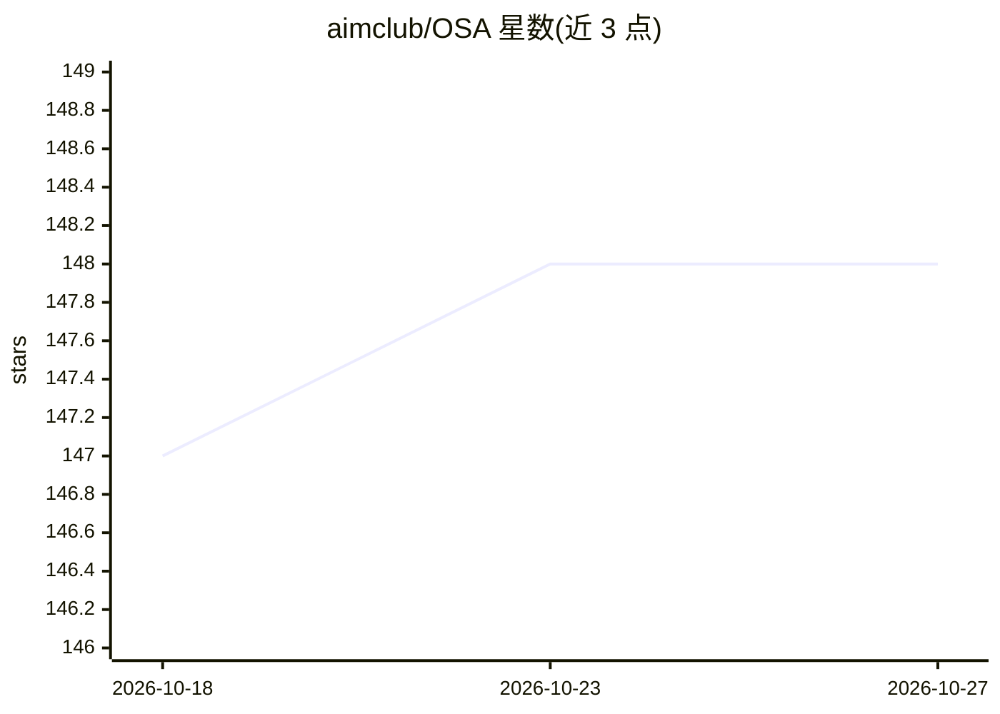

# aimclub/OSA

⭐ 148 · Python · BSD-3-Clause · 推送 2026-10-26 · [GitHub](https://github.com/aimclub/OSA) · [官网](https://aimclub.github.io/OSA/) · 组织维护

**用 LLM agent 自动改进开源仓库质量的工具**

面向科研开源项目的 LLM 工具：读取 GitHub/GitLab/Gitverse 仓库，自动生成 README、Python docstring、多级文档与 CI/CD workflow，克隆仓库、建分支并提交 pull request 实施变更；还提供仓库质量评分与论文声明抽取核验模式（--paper-analysis）。LLM 接入支持 OpenAI 兼容 API、Ollama、Openrouter、VseGPT、订阅制 Host（Codex CLI 协议）及 ITMO 托管模型。需 Python 3.11+，通过 pip、源码（pip/poetry）或 Docker 安装运行。

## 筛选速览

| 维度 | 判定 | 备注 |
|---|---|---|
| AI 角色 | `ai-native` | 本体是模型或模型工具 |
| 许可风险 | `permissive` | BSD-3-Clause |
| 部署形态 | `self-host` | docker 或自建部署 |
| 模型依赖 | local-ok | 支持本地模型 |
| 硬件要求 | — | 无带数字的原话,不猜 |
| 安装摩擦 | `low` | 无编译、无系统依赖或容器化 |
| 成熟度 | — | 结构信号不足 |

## 能力要点

- 自动生成 README、docstring、文档与 CI/CD workflow 并提交 PR
- 仓库质量评分与论文声明抽取核验（--paper-analysis）
- 支持 OpenAI 兼容 API、Ollama、Openrouter、VseGPT、Host 订阅及 ITMO 托管模型等多种 LLM 接入
- 提供 pip/poetry/Docker 三种安装运行方式

## 适用场景

- 为我的科研开源项目自动生成 README 和文档
- 自动补齐 Python 代码 docstring 并以 PR 形式提交
- 基于论文 PDF 生成 README 模板并核验论文声明
- 为 Python 仓库生成含测试与 PyPI 发布的 CI/CD 流水线

## 场景标签

`科研工具` `AI 写作` · 领域:内容生成

## 证据(README 行号)

> L22: OSA (Open-Source-Advisor) is a LLM-based tool for improving the quality of scientific open source projects and help
> L37: 1. **README file generation**: Automates the creation of a clear and structured README file for a repository, inclu
> L265: python -m osa_tool.run -r https://github.com/aimclub/OSA --api ollama --base-url http://[YOUR_OLLAMA_IP]:11434 --m

## 星数曲线

2026-10-18 147 → 2026-10-27 148（+1）

---
*卡片 v1 · prompt 1.4 · 生成 2026-10-23 · 置信度 high · 依据 README sha `10656c958bee` · [字段定义](../../DATASET.md)*
