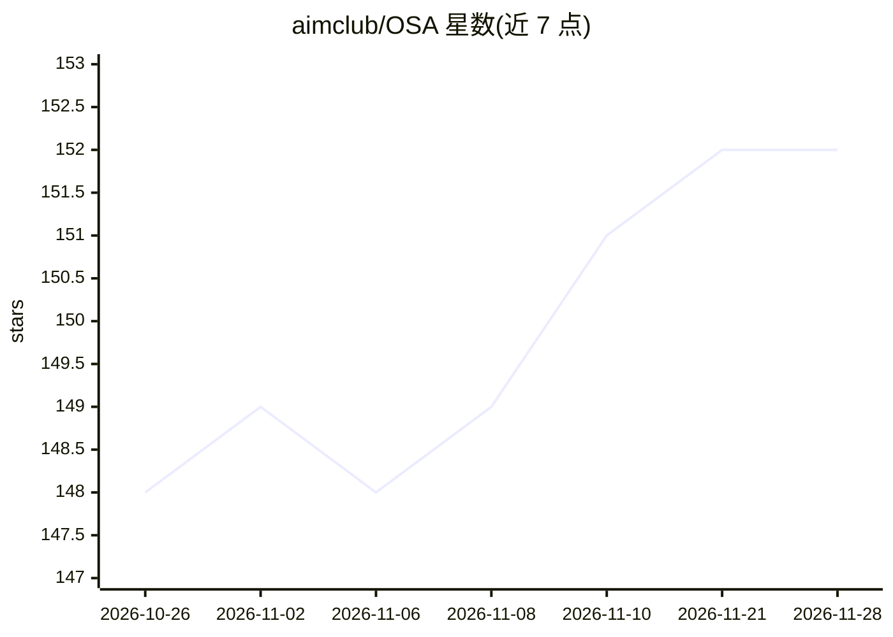

# aimclub/OSA

⭐ 152 · Python · BSD-3-Clause · 推送 2026-11-24 · [GitHub](https://github.com/aimclub/OSA) · [官网](https://aimclub.github.io/OSA/) · 组织维护 · 中文 README

**用 LLM agent 提升科研开源项目质量的工具**

OSA（Open-Source-Advisor）面向科研开源项目，自动化生成 README、Python docstring 文档、CI/CD 工作流，并可克隆仓库、建分支、提交修改并创建 Pull Request。支持通过 API（OpenAI 兼容端点、VseGPT、Ollama、GigaChat）、订阅制 Host provider 或 ITMO 托管的 osa_bot 调用 LLM。提供论文仓库分析模式，抽取论文声明并对照仓库验证，可选仓库质量评分。通过 PyPI、源码或 Docker 安装，需 Python 3.11+ 与 Git 平台 token。

## 筛选速览

| 维度 | 判定 | 备注 |
|---|---|---|
| AI 角色 | `ai-native` | 本体是模型或模型工具 |
| 许可风险 | `permissive` | BSD-3-Clause |
| 部署形态 | `self-host` | docker 或自建部署 |
| 模型依赖 | local-ok | 支持本地模型 |
| 硬件要求 | — | 无带数字的原话,不猜 |
| 安装摩擦 | `low` | 无编译、无系统依赖或容器化 |
| 成熟度 | — | 结构信号不足 |

## 能力要点

- 自动生成 README、docstring 与 CI/CD 工作流并创建 PR
- 论文仓库分析模式：抽取论文声明并对照仓库验证
- 支持多 LLM 接入：OpenAI 兼容端点、Ollama、GigaChat、Host provider
- 仓库质量评分与按任务分别配置模型的 TOML 配置

## 适用场景

- 为基于论文的仓库自动生成 README 与文档
- 给 Python 科研仓库补齐单元测试、格式检查、PyPI 发布等 CI 流水线
- 核验论文中的声明是否在仓库中实现
- 批量评估开源仓库的 README、license 等规范性

## 场景标签

`科研工具` `编码 Agent` · 领域:编码与开发

## 证据(README 行号)

> L22: OSA (Open-Source-Advisor) is a LLM-based tool for improving the quality of scientific open source projects and help
> L42: 3. **Automatic implementation of changes**: Clones the repository, creates a branch, commits and pushes changes, an
> L45: 4. **Various LLMs**: Use OSA with an LLM accessible via API (e.g., OpenAI, VseGPT, Ollama), a local server, or try

## 星数曲线

2026-10-26 148 → 2026-11-28 152（+4）

---
*卡片 v1 · prompt 1.4 · 生成 2026-11-27 · 置信度 high · 依据 README sha `18ddeabf3b91` · [字段定义](../../DATASET.md)*
