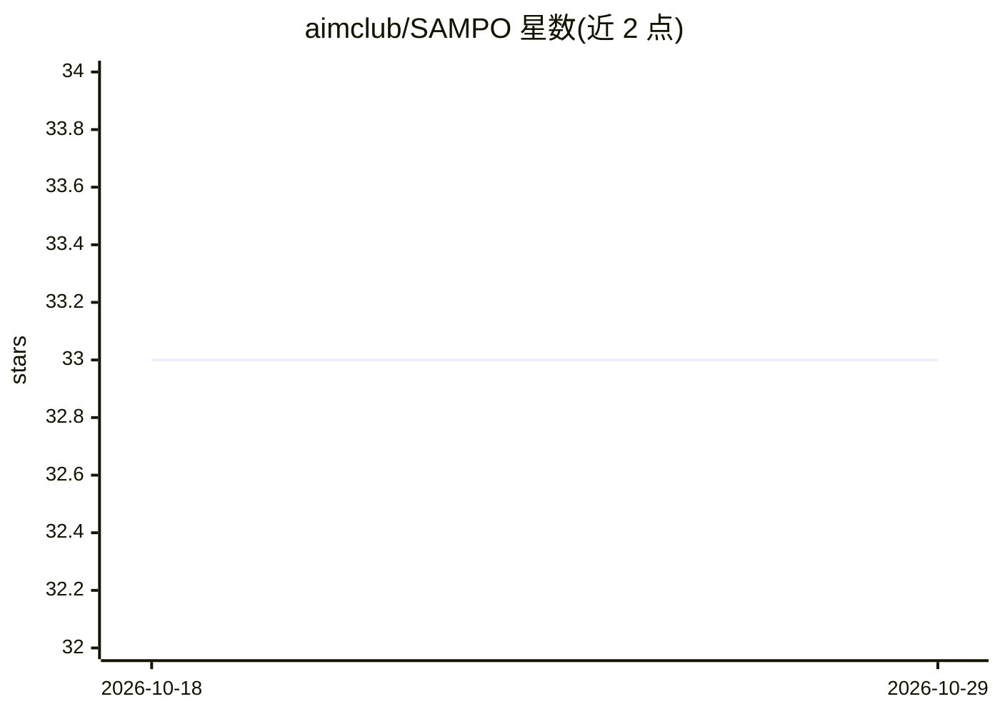

# aimclub/SAMPO

⭐ 33 · Jupyter Notebook · BSD-3-Clause · 推送 2026-04-11 · [GitHub](https://github.com/aimclub/SAMPO) · [官网](https://sampo.readthedocs.io) · 组织维护

**制造业工序调度优化框架：生成满足约束的调度方案**

面向制造过程调度的开源 Python 框架，输入任务图（工作项、依赖连接）与承包商资源约束及优化指标，生成任务排序与资源分配方案。核心结合启发式（Topological、HEFT/HEFTBetween）与遗传算法，支持多准则优化（时间/资源/成本、Pareto 前沿），可处理 2-10 千任务规模项目。提供合成工作图生成模块与 Pipeline API。由 ITMO 大学强 AI 研究中心支持，3-Clause BSD 许可，pip 安装。

## 筛选速览

| 维度 | 判定 | 备注 |
|---|---|---|
| AI 角色 | `ai-native` | 本体是模型或模型工具 |
| 许可风险 | `permissive` | BSD-3-Clause |
| 部署形态 | `library` | 以包/库形式分发 |
| 模型依赖 | — | README 未给出锁定关系 |
| 硬件要求 | — | 无带数字的原话,不猜 |
| 安装摩擦 | `low` | 无编译、无系统依赖或容器化 |
| 成熟度 | — | 结构信号不足 |

## 能力要点

- 启发式（Topological/HEFT/HEFTBetween）与遗传算法调度器
- 多准则优化与 Pareto 最优方案集构建
- 支持 2-10 千任务的大型项目
- 合成工作图生成模块与 Pipeline API

## 适用场景

- 制造业项目在资源约束下生成调度计划
- 研究与比较启发式与遗传调度算法
- 生成指定结构的合成任务图用于测试

## 场景标签

`工作流自动化` · 领域:效率与自动化

## 证据(README 行号)

> L24: **SAMPO** is an open-source framework for adaptive manufacturing processes scheduling. This framework is distribute
> L26: It provides toolbox for generating schedules of manufacturing process under the constraints imposed by the subject 
> L157: The study is supported by the `Research Center Strong Artificial Intelligence in Industry <https://sai.itmo.ru/>`_

## 星数曲线

2026-10-18 33 → 2026-10-29 33（+0）

---
*卡片 v1 · prompt 1.4 · 生成 2026-10-25 · 置信度 mid · 依据 README sha `dbf7ebf48007` · [字段定义](../../DATASET.md)*
