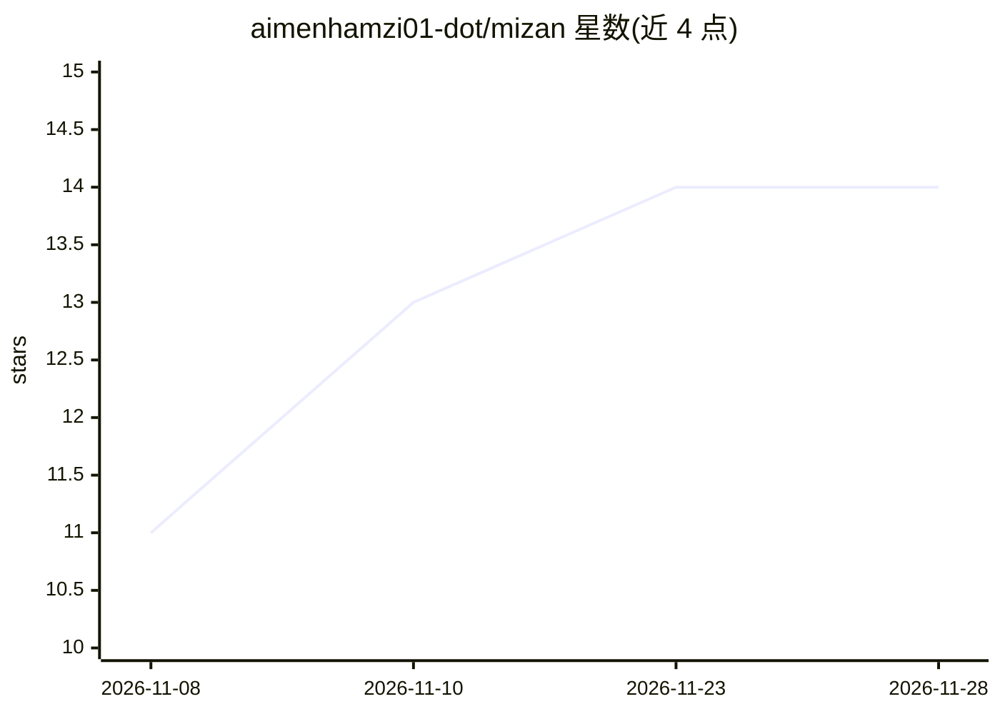

# aimenhamzi01-dot/mizan

⭐ 14 · Python · MIT · 推送 2026-11-05 · [GitHub](https://github.com/aimenhamzi01-dot/mizan) · 个人维护

**安全漏洞报告分诊工作台：AI 辅助整理证据，人工做决定**

自托管的漏洞报告分诊工作台：将报告与源码片段存为案例，调用 Meta Muse 模型生成结构化分析与带来源的可溯证据摘录，检测提示注入尝试，仅做文本模式检查、从不执行提交内容，最终由授权评审员记录处置决定，AI 建议与人工结论分离保存。通过显式确认后才将报告发送至配置的 Meta 端点，支持工作区、角色权限与 API 密钥加密存储。Python 3.9+ 与 Docker 运行，附 API 参考与离线评估器。

## 筛选速览

| 维度 | 判定 | 备注 |
|---|---|---|
| AI 角色 | `ai-native` | 本体是模型或模型工具 |
| 许可风险 | `permissive` | MIT |
| 部署形态 | `self-host` | docker 或自建部署 |
| 模型依赖 | — | README 未给出锁定关系 |
| 硬件要求 | — | 无带数字的原话,不猜 |
| 安装摩擦 | `low` | 无编译、无系统依赖或容器化 |
| 成熟度 | — | 结构信号不足 |

## 能力要点

- 每个引用摘录关联来源与位置，形成可追溯证据链
- 仅推理不执行：对提交源码只做有界文本模式检查
- 基于 Muse Spark 的安全分诊模型路由，支持启用 muse-wonder 实验模型
- 与 Phantom 通过签名任务清单交接扫描结果

## 适用场景

- 安全团队整理、核验漏洞报告并留痕评审决定
- 漏洞研究者核查报告声明与源码证据的对应关系
- 在自托管环境中管理案例、角色与评审流程

## 场景标签

`网络安全` · 领域:学习与行业

## 证据(README 行号)

> L7: **A self-hosted workbench that turns vulnerability reports into structured, evidence-linked cases for expert review.
> L33: 2. **Request AI assistance.** Choose an enabled Muse model and confirm the report and source may be sent to the con
> L35: 4. **Record a human decision.** An authorized reviewer records a disposition and optional note. The AI recommendati

## 星数曲线

2026-11-08 11 → 2026-11-28 14（+3）

---
*卡片 v1 · prompt 1.4 · 生成 2026-11-18 · 置信度 high · 依据 README sha `94597f557217` · [字段定义](../../DATASET.md)*
