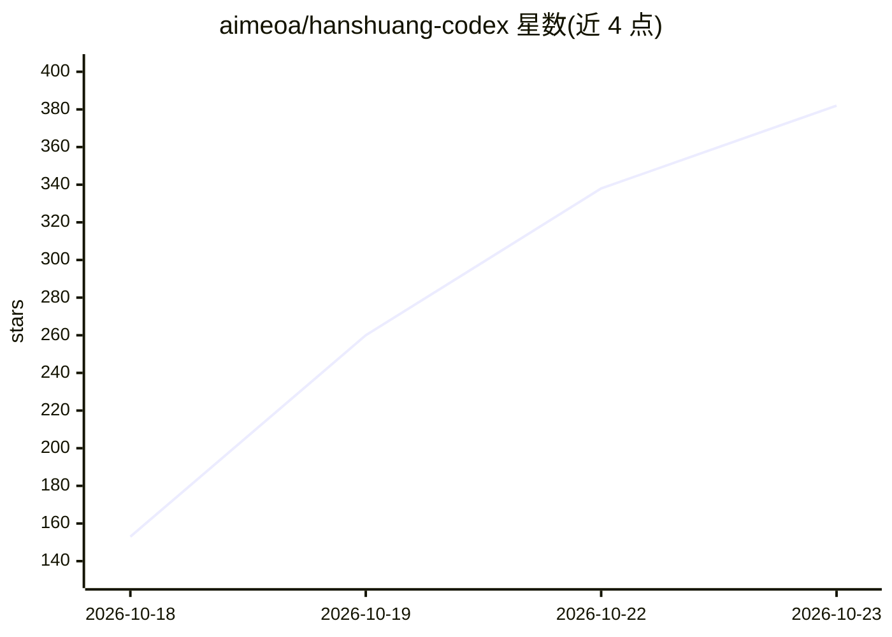

# aimeoa/hanshuang-codex

⭐ 382 · Lua · 推送 2026-10-17 · [GitHub](https://github.com/aimeoa/hanshuang-codex) · 个人维护 · 中文 README

**面向九个 AI 编程工具的提示词注入管理桌面工具**

基于 Electron + PowerShell 的 Windows 桌面工具：向 Codex / ZCode / Cursor / OpenCode / Claude / WorkBuddy / DeepSeek Harness / 豆包等九个目标的本地配置（如 AGENTS.md / CLAUDE.md / 记忆档案）安装、卸载用户自备的提示词文件，附带技能库管理与随包的 Seep 逆向工作台（MCP 服务 + 9 技能 + 案例库，约 300 MB）。提示词不随包分发，需用户自行粘贴到 memory/ 目录；提供安装备份与还原、便携版打包与卸载清扫脚本。

## 筛选速览

| 维度 | 判定 | 备注 |
|---|---|---|
| AI 角色 | `ai-ecosystem` | LLM/agent 周边工具 |
| 许可风险 | `none` | — |
| 部署形态 | `library` | 以包/库形式分发 |
| 模型依赖 | — | README 未给出锁定关系 |
| 硬件要求 | — | 无带数字的原话,不猜 |
| 安装摩擦 | `low` | 无编译、无系统依赖或容器化 |
| 成熟度 | — | 结构信号不足 |

## 能力要点

- 九个目标页均支持安装 / 卸载 / 还原原始记忆
- 提示词从 memory/ 目录读取，不随包分发，空文件会报错不写入
- 随包 Seep 逆向工作台（Radare2 / JADX / Apktool / Frida 的 MCP 封装）
- 打包产物为免安装便携版 zip，附卸载清扫脚本

## 适用场景

- 向本机 AI 编程工具注入自定义提示词与技能
- 部署并自检 Seep 逆向分析工具链
- 管理本机 Codex 技能的启停

## 场景标签

`提示工程` · 领域:Agent 开发

## 证据(README 行号)

> L14: 九个破甲目标页（Codex / ZCode / Cursor / OpenCode / Claude / WorkBuddy 国际版 /
> L19: |安装|各目标页的安装按钮|`install*.ps1 -SourcePrompt memory/破甲记忆.md` + 随包技能库|
> L38: 写 `~/.pi/agent`（技能 / 提示词 / MCP）→ 生成 Claude Code / DSH / OpenCode 配置 → 自检。

## 星数曲线

2026-10-18 153 → 2026-10-23 382（+229）

---
*卡片 v1 · prompt 1.4 · 生成 2026-10-21 · 置信度 high · 依据 README sha `f10c1df56080` · [字段定义](../../DATASET.md)*
