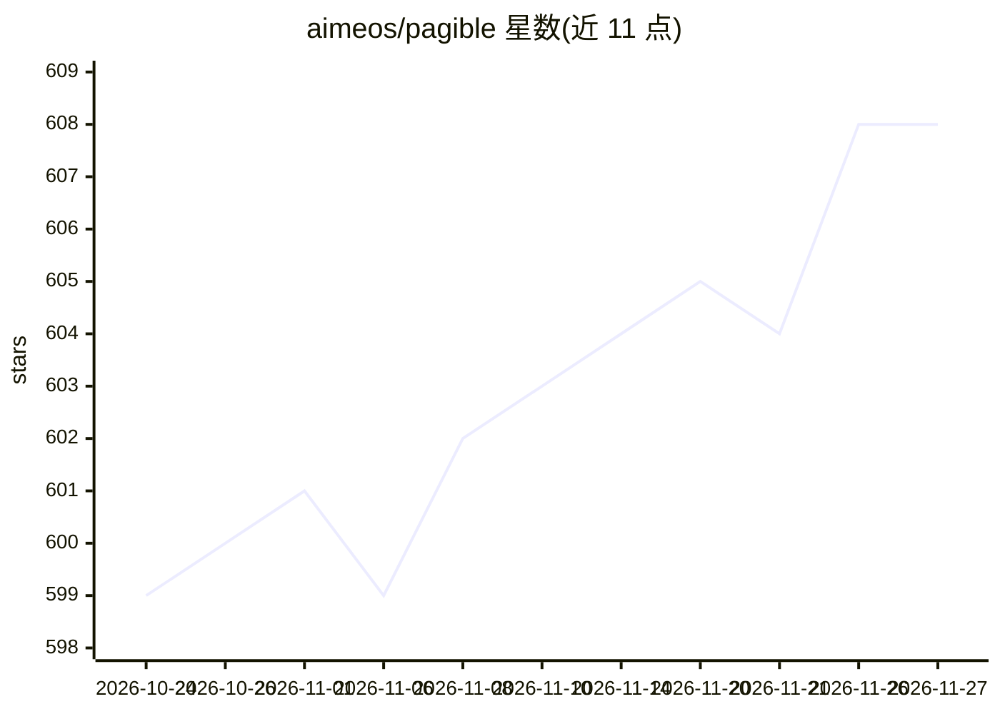

# aimeos/pagible

⭐ 608 · PHP · MIT · 推送 2026-11-25 · [GitHub](https://github.com/aimeos/pagible) · [官网](https://pagible.com) · 组织维护

**面向 Laravel 开发者的 AI 驱动 API-first CMS 包**

可安装进任意 Laravel 应用的内容管理系统：结构化内容、层级页面树、版本快照与草稿发布调度、多语言、多域名与多租户、JSON:API 与 GraphQL 双 API、全文搜索、页面指标、订阅付费访问等。AI 部分通过 Prisma PHP 集成多家 LLM 供应商，用于撰写、翻译、发布内容与创建编辑图片，并提供 AI 对话操作页面；另含 40+ MCP 工具供外部 AI agent 管理内容，以及供编码 agent 使用的主题开发技能。支持从 WordPress、TYPO3、Drupal、Joomla 导入。

## 筛选速览

| 维度 | 判定 | 备注 |
|---|---|---|
| AI 角色 | `ai-enhanced` | 去掉 AI 部分产品仍成立 |
| 许可风险 | `permissive` | MIT |
| 部署形态 | `library` | 以包/库形式分发 |
| 模型依赖 | — | README 未给出锁定关系 |
| 硬件要求 | — | 无带数字的原话,不猜 |
| 安装摩擦 | `low` | 无编译、无系统依赖或容器化 |
| 成熟度 | — | 结构信号不足 |

## 能力要点

- AI 生成/增强草稿与图片，AI 对话创建、翻译并发布页面
- 40+ MCP 工具供 Claude、ChatGPT、Cursor 等 agent 管理内容
- JSON:API 前端只读接口 + GraphQL 管理接口，模块化单体仓库分拆为多个可选包
- 基于嵌套集页面树与不可变版本快照，匿名页面响应全量缓存并自动失效

## 适用场景

- 在现有 Laravel 应用中搭建博客或多租户、多域名站点
- 让 AI 对话或 MCP agent 代为创建、翻译、发布页面
- 从 WordPress/TYPO3/Drupal/Joomla 迁移内容
- 搭建需要订阅付费访问页面或全站全文搜索的站点

## 场景标签

`AI 写作` `图像生成` · 领域:内容生成

## 证据(README 行号)

> L9: PagibleAI CMS is an API-first content management system you can install into any Laravel
> L19: * **AI-Powered** - AI generates and enhances drafts and images
> L61: * **AI** integrates LLM providers through Prisma PHP for chat, content generation, image manipulation, transcriptio

## 星数曲线

2026-10-24 599 → 2026-11-27 608（+9）

---
*卡片 v1 · prompt 1.4 · 生成 2026-11-26 · 置信度 mid · 依据 README sha `70278042ee71` · [字段定义](../../DATASET.md)*
