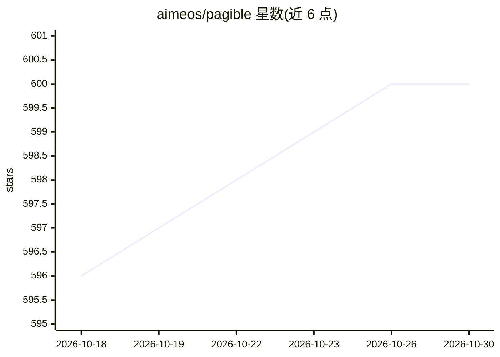

# aimeos/pagible

⭐ 600 · PHP · MIT · 推送 2026-10-29 · [GitHub](https://github.com/aimeos/pagible) · [官网](https://pagible.com) · 组织维护

**可装入 Laravel 应用的 AI 驱动无头 CMS 包**

API 优先的 Laravel CMS 扩展包，可安装到已有 Laravel 应用中：提供结构化内容管理、层级页面树、版本化与审计追踪、JSON:API 前端接口与 GraphQL 管理 API，支持多语言、多域名与多租户，可从单页 SQLite 扩展到数据库集群。AI 部分通过 Prism/Prisma PHP 集成多家服务商，用于内容生成、图像处理、翻译与音视频分析，需自行配置 API key；另提供 30+ 工具的 MCP API 供 LLM 驱动内容管理。技术栈为 PHP 8.2+/Laravel 11-13/Vue 3，通过 Composer 安装。

## 筛选速览

| 维度 | 判定 | 备注 |
|---|---|---|
| AI 角色 | `ai-enhanced` | 去掉 AI 部分产品仍成立 |
| 许可风险 | `permissive` | MIT |
| 部署形态 | `None` |  |
| 模型依赖 | — | README 未给出锁定关系 |
| 硬件要求 | — | 无带数字的原话,不猜 |
| 安装摩擦 | `low` | 无编译、无系统依赖或容器化 |
| 成熟度 | — | 结构信号不足 |

## 能力要点

- JSON:API 前端 API + GraphQL 管理 API（Lighthouse）
- 通过 Prism/Prisma PHP 集成 AI 服务商：内容生成、图像处理、翻译、音视频分析
- 30+ 工具的 MCP API 供 LLM 驱动内容管理
- 多语言/多域名/多租户，从 SQLite 单页到数据库集群

## 适用场景

- 在已有 Laravel 应用中添加无头 CMS 能力
- 用 AI 生成草稿、图片与多语言翻译内容
- 让 LLM 通过 MCP API 管理站点内容
- 通过 Stripe/Paddle/Mollie 出售付费页面访问

## 场景标签

`AI 写作` `图像视频处理` · 领域:内容生成

## 证据(README 行号)

> L9: PagibleAI CMS is an API-first content management system that can be installed into any existing Laravel application.
> L16: * **AI-Powered** - AI generates/enhances drafts and images
> L55: * **AI** integrates LLM providers through Prism/Prisma PHP for content generation, image manipulation, and translat

## 星数曲线

2026-10-18 596 → 2026-10-30 600（+4）

---
*卡片 v1 · prompt 1.4 · 生成 2026-10-21 · 置信度 high · 依据 README sha `51ed0dd25e26` · [字段定义](../../DATASET.md)*
