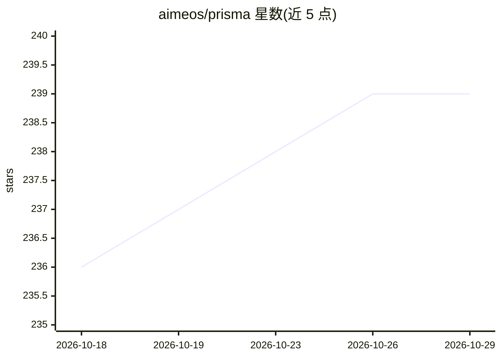

# aimeos/prisma

⭐ 239 · PHP · MIT · 推送 2026-10-26 · [GitHub](https://github.com/aimeos/prisma) · [官网](https://php-prisma.org) · 组织维护

**PHP 多模态 LLM 统一集成包：一套接口接入 40+ 供应商**

面向 PHP 开发者的轻量级多模态 LLM 集成包：以统一的 Text/Image/Audio/Video 四类 API 抽象接入 40 余家供应商（OpenAI、Anthropic、Google Gemini、Azure、Bedrock、Ollama 等），并给出各供应商能力矩阵（如 transcribe/imagine/speak/write）。提供流式输出、结构化输出、Schema/工具构建器、多轮对话、系统提示、思考预算、HTTP 自动重试与响应大小限制等机制；openai 文本供应商走 Responses API，仅支持 Chat Completions 的网关需换用 ollama 等供应商或自定义实现。通过 composer 安装，基于 Guzzle HTTP 客户端。

## 筛选速览

| 维度 | 判定 | 备注 |
|---|---|---|
| AI 角色 | `ai-ecosystem` | LLM/agent 周边工具 |
| 许可风险 | `permissive` | MIT |
| 部署形态 | `None` |  |
| 模型依赖 | local-ok | 支持本地模型 |
| 硬件要求 | — | 无带数字的原话,不猜 |
| 安装摩擦 | `low` | 无编译、无系统依赖或容器化 |
| 成熟度 | — | 结构信号不足 |

## 能力要点

- 统一接口覆盖文本、图像、音频、视频四类多模态 API
- 支持 40+ 供应商并附各模态能力矩阵表
- 提供流式输出、结构化输出、Schema 构建器与自定义/并发工具机制
- 内置 HTTP 自动重试（429/5xx）与响应大小限制（默认 64 MiB）

## 适用场景

- 在 PHP 应用中用同一套代码切换多家 LLM/多模态供应商
- 构建带工具调用与结构化输出的文本生成应用
- 接入语音转写、图像生成/编辑、视频生成等多模态能力

## 场景标签

`模型网关` · 领域:Agent 开发

## 证据(README 行号)

> L3: Light-weight PHP package for integrating multi-media and text related Large Language Models (LLMs) into your applica
> L100: ## Supported providers
> L243: ```

## 星数曲线



2026-10-18 236 → 2026-10-29 239（+3）


---
*卡片 v1 · prompt 1.4 · 生成 2026-10-22 · 置信度 high · 依据 README sha `05236e4fdd12` · [字段定义](../../DATASET.md)*
