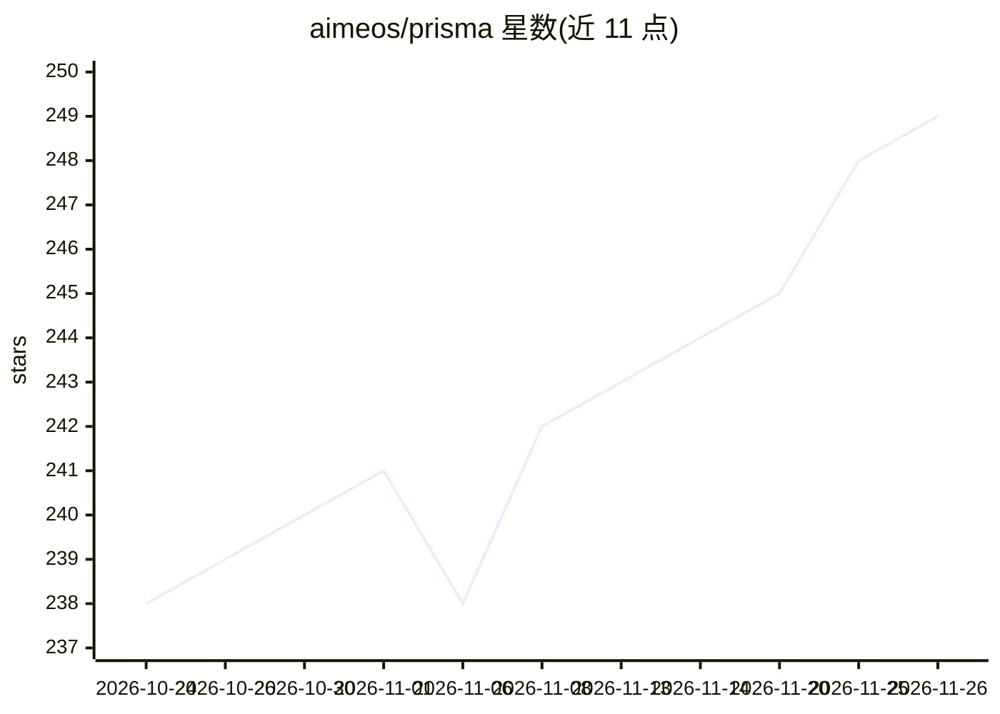

# aimeos/prisma

⭐ 249 · PHP · MIT · 推送 2026-11-21 · [GitHub](https://github.com/aimeos/prisma) · [官网](https://php-prisma.org) · 组织维护

**PHP 统一接口库：接入多媒体与文本 LLM 服务**

轻量级 PHP 包，通过统一接口将多媒体与文本类 LLM 服务接入应用。支持音频（合成、转写、降噪、换声）、图像（生成、编辑、OCR、抠图、放大）、文本（生成、流式、结构化输出、翻译、嵌入）、视频（生成、重绘、延长）四类 API，接入了数十家服务商，并通过 OpenAI 兼容网关扩展更多服务。提供 Schema 构建器、工具调用、系统提示词、多轮对话、速率限制与重试等配置接口，经 Composer 安装。

## 筛选速览

| 维度 | 判定 | 备注 |
|---|---|---|
| AI 角色 | `ai-ecosystem` | LLM/agent 周边工具 |
| 许可风险 | `permissive` | MIT |
| 部署形态 | `None` |  |
| 模型依赖 | local-ok | 支持本地模型 |
| 硬件要求 | — | 无带数字的原话,不猜 |
| 安装摩擦 | `low` | 无编译、无系统依赖或容器化 |
| 成熟度 | — | 结构信号不足 |

## 能力要点

- 音频/图像/文本/视频四类 API 的统一调用接口
- 接入数十家服务商并支持 OpenAI 兼容网关（Responses API 与 Chat Completions）
- fluent Schema 构建器与工具调用（含并发、装饰、内置 provider 工具）
- 重试、速率限制、thinking budget、citations 等请求/响应元信息配置

## 适用场景

- 在 PHP 应用中用同一套代码切换不同 LLM 服务商
- 调用图像生成、编辑与音频转写等多媒体模型能力
- 为应用接入 OpenAI 兼容的第三方网关或本地推理服务

## 场景标签

`图像生成` `语音识别` `OCR` · 领域:内容生成

## 证据(README 行号)

> L3: Light-weight PHP package for integrating multi-media and text related Large Language Models (LLMs) into your applica
> L101: ## Supported providers
> L278: ## Installation

## 星数曲线

2026-10-24 238 → 2026-11-26 249（+11）

---
*卡片 v1 · prompt 1.4 · 生成 2026-11-26 · 置信度 high · 依据 README sha `e3db9d84c046` · [字段定义](../../DATASET.md)*
