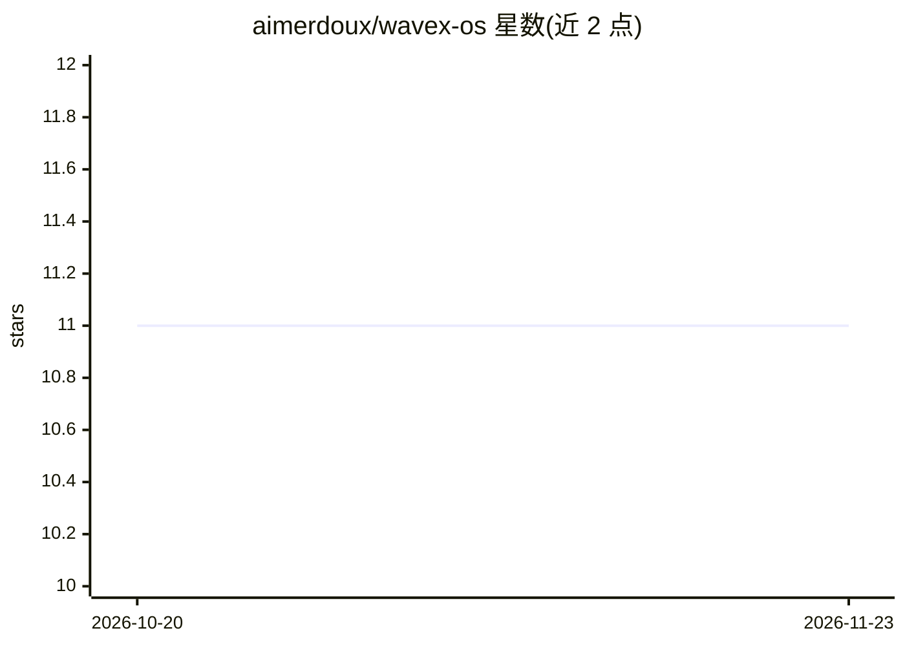

# aimerdoux/wavex-os

⭐ 11 · TypeScript · NOASSERTION · 推送 2026-09-29 · [GitHub](https://github.com/aimerdoux/wavex-os) · [官网](https://github.com/aimerdoux/wavex-os) · 组织维护

**在本机运行 AI agent 公司的向导式操作系统**

以本地 localhost 向导形式运行：用户回答五个问题后，系统从 165 个模板中生成 agent 花名册，构建工作流分配，执行 Monte Carlo 模拟并生成签名的公司清单，随后激活到 Paperclip 运行时；每个 agent 具备心跳、KPI、预算与汇报链。推理通过本机 Claude Max OAuth 完成，不使用 API key、不做远程推理与遥测。需要 Node ≥18、pnpm ≥9 与 Claude Max 订阅。含 Mission Control 仪表盘与 launchd 运维模板。

## 筛选速览

| 维度 | 判定 | 备注 |
|---|---|---|
| AI 角色 | `ai-ecosystem` | LLM/agent 周边工具 |
| 许可风险 | `permissive` | NOASSERTION |
| 部署形态 | `library` | 以包/库形式分发 |
| 模型依赖 | locked-api |  |
| 硬件要求 | — | 无带数字的原话,不猜 |
| 安装摩擦 | `low` | 无编译、无系统依赖或容器化 |
| 成熟度 | `idea` | |

## 能力要点

- 五问向导：从 165 个 agent 模板生成花名册与工作流计划
- Finalize 阶段生成签名 company.manifest.json 并运行 Monte Carlo 模拟
- 激活后接入 Paperclip 运行时：心跳、KPI、预算与董事会审批
- 本机 keychain 读取 Claude Max OAuth，无 API key 与遥测

## 适用场景

- 在本机搭建并运行一个由多 agent 组成的模拟公司
- 为 solo founder 按产品阶段自动裁剪 agent 编制（minimal kernel 至 formal_9）
- 通过 Telegram/Slack/邮件接收董事会信号与运维告警

## 场景标签

`多智能体` `工作流自动化` · 领域:Agent 开发

## 证据(README 行号)

> L12: WaveX OS is a localhost-first wizard that materializes an AI agent company in about an hour. You answer five questi
> L14: Your data and inference stay on your machine. Spawned agents use your Claude Max OAuth via a wrapper that reads the

## 星数曲线

2026-10-20 11 → 2026-11-23 11（+0）

---
*卡片 v1 · prompt 1.4 · 生成 2026-11-18 · 置信度 high · 依据 README sha `5a6ecf874616` · [字段定义](../../DATASET.md)*
