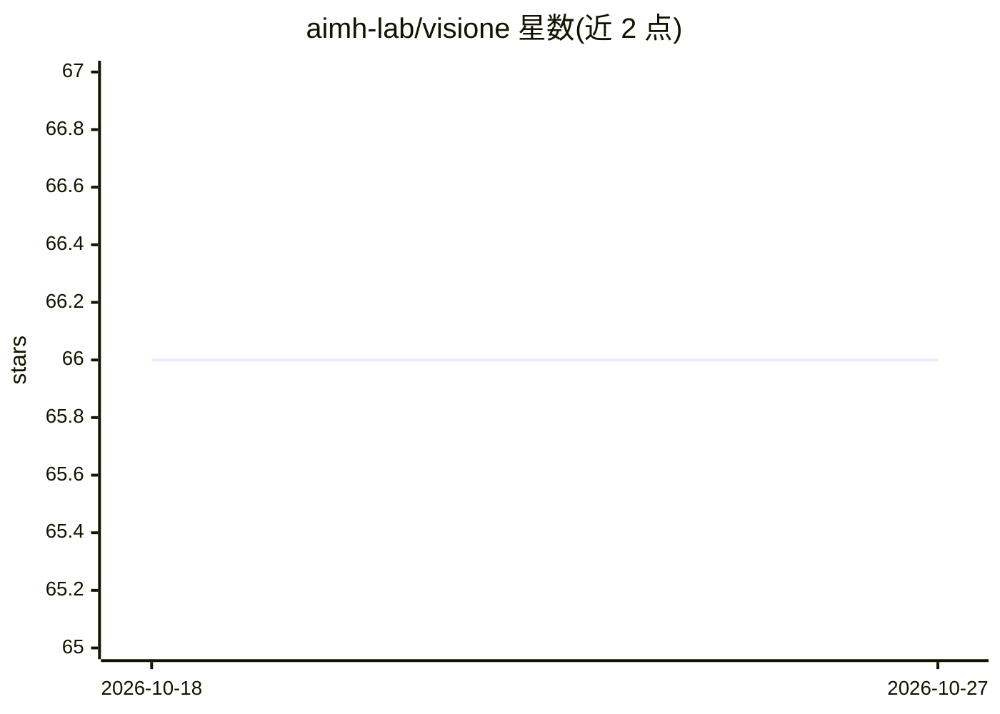

# aimh-lab/visione

⭐ 66 · JavaScript · EUPL-1.2 · 推送 2026-10-19 · [GitHub](https://github.com/aimh-lab/visione) · [官网](https://visione.isti.cnr.it/) · 组织维护

**面向视频集合的交互式 AI 检索系统：文本/图像/对象多方式搜索视频**

VISIONE 是一个基于 AI 的交互式视频检索系统：用户通过 Web UI 以多语言文本、图像视觉相似度、对象/颜色存在与位置条件、时序先后关系等多种方式搜索视频集合。系统通过 CLI 五步流程（init/import/analyze/index/serve）运行：导入时做场景检测与关键帧抽取，分析在 Docker 容器中 GPU 加速执行，索引使用 Lucene 与 FAISS，最后以 docker compose 启动前后端服务。要求 Python>=3.7 与支持 NVIDIA GPU 的 Docker 环境，测试配置为 Ubuntu 22.04 + RTX 2080Ti。

## 筛选速览

| 维度 | 判定 | 备注 |
|---|---|---|
| AI 角色 | `ai-native` | 本体是模型或模型工具 |
| 许可风险 | `viral` | EUPL-1.2 |
| 部署形态 | `self-host` | docker 或自建部署 |
| 模型依赖 | — | README 未给出锁定关系 |
| 硬件要求 | — | 无带数字的原话,不猜 |
| 安装摩擦 | `low` | 无编译、无系统依赖或容器化 |
| 成熟度 | `idea` | |

## 能力要点

- 多语言文本到视频、图像相似度、对象/颜色/时序等多种检索方式
- 导入流程自动执行场景检测与关键帧抽取
- GPU 加速的 Docker 化视频分析，Lucene + FAISS 索引
- Web UI 提供视频浏览与播放

## 适用场景

- 在大型视频集合中用自然语言描述查找视频片段
- 以示例图像进行视觉相似视频检索
- 按对象出现次数、颜色与位置条件筛选视频

## 场景标签

`语义搜索` · 领域:知识与检索

## 证据(README 行号)

> L11: - :speech_balloon: **Multilingual** text-to-video retrieval (search by text)
> L12: - :framed_picture: **Visual** similarity search (search by image)
> L16: - :rocket: **Dockerized** and **GPU-enabled** video analysis

## 星数曲线

2026-10-18 66 → 2026-10-27 66（+0）

---
*卡片 v1 · prompt 1.4 · 生成 2026-10-24 · 置信度 high · 依据 README sha `cf2d71427b9d` · [字段定义](../../DATASET.md)*
