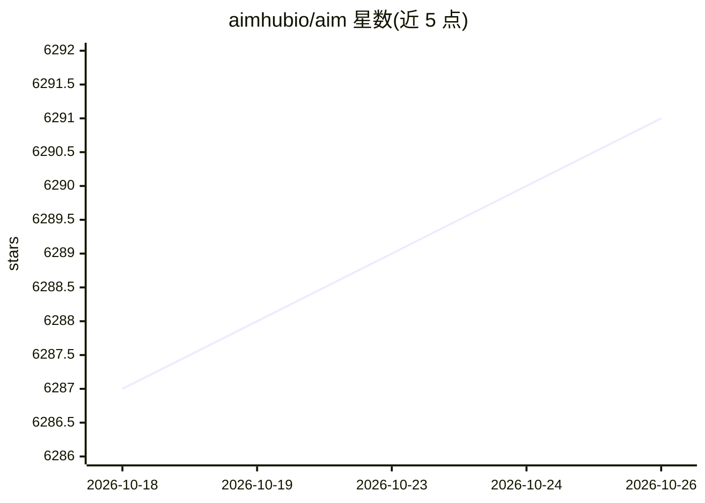

# aimhubio/aim

⭐ 6,291 · Python · Apache-2.0 · 推送 2026-10-24 · [GitHub](https://github.com/aimhubio/aim) · [官网](https://aimstack.io) · 组织维护

**自托管 ML 实验追踪工具：记录训练运行与元数据并对比**

开源自托管的机器学习实验追踪工具，面向需要管理数以万计训练运行的 ML 团队。通过 SDK 在训练代码中记录指标、参数、图像、音频、分布等元数据，提供 UI 进行运行对比、分组聚合与查询，并以 Python SDK 支持程序化访问。内置对 PyTorch Lightning、Hugging Face、Keras、XGBoost 等十余个框架的集成回调，以及 TensorBoard/MLflow/W&B 日志迁移转换器。支持远程集中式追踪服务器与 Kubernetes 部署。

## 筛选速览

| 维度 | 判定 | 备注 |
|---|---|---|
| AI 角色 | `ai-ecosystem` | LLM/agent 周边工具 |
| 许可风险 | `permissive` | Apache-2.0 |
| 部署形态 | `library` | 以包/库形式分发 |
| 模型依赖 | — | README 未给出锁定关系 |
| 硬件要求 | — | 无带数字的原话,不猜 |
| 安装摩擦 | `low` | 无编译、无系统依赖或容器化 |
| 成熟度 | — | 结构信号不足 |

## 能力要点

- 记录训练运行指标、参数、图像、音频、分布等元数据
- UI 提供运行对比、分组聚合与 Python 表达式查询
- 内置十余个 ML 框架集成回调与 TensorBoard/MLflow/W&B 迁移转换器
- 支持远程集中追踪服务器与 Kubernetes 部署

## 适用场景

- 我在训练模型时追踪并对比多次实验的指标与参数
- 我们团队需要在多台机器上集中收集实验数据
- 我想从 TensorBoard 或 MLflow 迁移已有实验日志

## 场景标签

`MLOps` · 领域:训练与推理

## 证据(README 行号)

> L7:  Aim logs your training runs and any AI Metadata, enables a beautiful UI to compare, observe them and an API to quer
> L37: Aim is an open-source, self-hosted ML experiment tracking tool designed to handle 10,000s of training runs.

## 星数曲线

2026-10-18 6,287 → 2026-10-26 6,291（+4）

---
*卡片 v1 · prompt 1.4 · 生成 2026-10-20 · 置信度 high · 依据 README sha `a41a14d091e3` · [字段定义](../../DATASET.md)*
