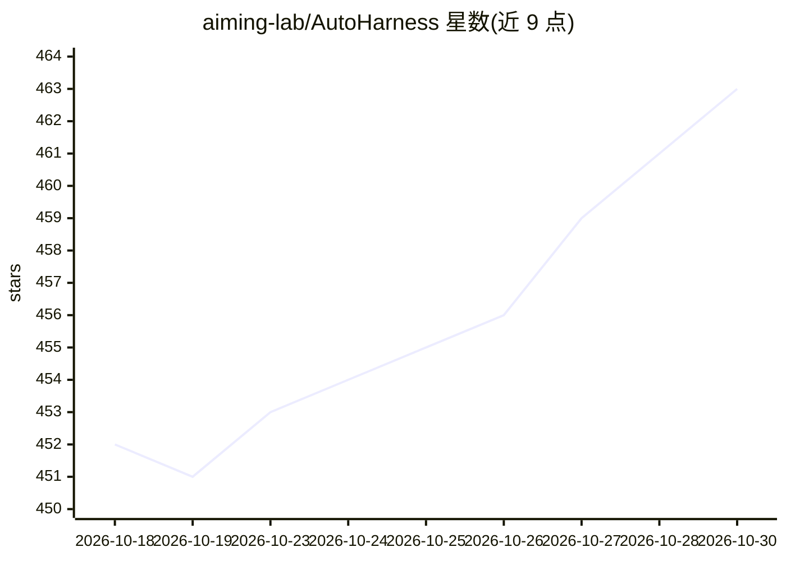

# aiming-lab/AutoHarness

⭐ 463 · Python · MIT · 推送 2026-04-02 · [GitHub](https://github.com/aiming-lab/AutoHarness) · 组织维护 · 中文 README

**给 AI Agent 开发者的治理框架：包裹 LLM 客户端实现工具治理**

AutoHarness 是面向 AI agent 开发者的轻量级治理框架，核心机制是 6 步（最多 14 步）治理管线：每次工具调用经过解析校验、风险分类、权限检查、执行、输出消毒与 JSONL 审计。支持 token 预算管理、多层上下文管理、多 agent 角色配置、逐调用成本归因与 YAML constitution 配置，三种管线模式（Core/Standard/Enhanced，默认 Enhanced）。通过 wrap 任意 LLM 客户端 2 行代码接入，另提供 CLI 与 AgentLoop。MIT 许可，Python 3.10+，源码 pip 安装。

## 筛选速览

| 维度 | 判定 | 备注 |
|---|---|---|
| AI 角色 | `ai-ecosystem` | LLM/agent 周边工具 |
| 许可风险 | `permissive` | MIT |
| 部署形态 | `library` | 以包/库形式分发 |
| 模型依赖 | — | README 未给出锁定关系 |
| 硬件要求 | — | 无带数字的原话,不猜 |
| 安装摩擦 | `low` | 无编译、无系统依赖或容器化 |
| 成熟度 | — | 结构信号不足 |

## 能力要点

- 6-14 步工具治理管线（校验/风险分类/权限/消毒/审计）
- 2 行代码 wrap 任意 LLM 客户端，宣称 0 厂商锁定
- token 预算与截断控制、逐调用成本归因
- 多 agent 角色配置与 YAML constitution

## 适用场景

- 我的 agent 需要拦截危险工具调用并留下审计日志
- 多 agent 系统按角色划分权限与治理策略
- 控制上下文增长并追踪每次工具调用的成本

## 场景标签

`Agent 框架` · 领域:Agent 开发

## 证据(README 行号)

> L33: AutoHarness is a lightweight governance framework **so every agent can have its *aha* moment.**
> L48: client = AutoHarness.wrap(OpenAI())
> L116: 1. Parse & Validate  →  2. Risk Classify  →  3. Permission Check

## 星数曲线

2026-10-18 452 → 2026-10-30 463（+11）

---
*卡片 v1 · prompt 1.4 · 生成 2026-10-22 · 置信度 high · 依据 README sha `0e0b7190c897` · [字段定义](../../DATASET.md)*
