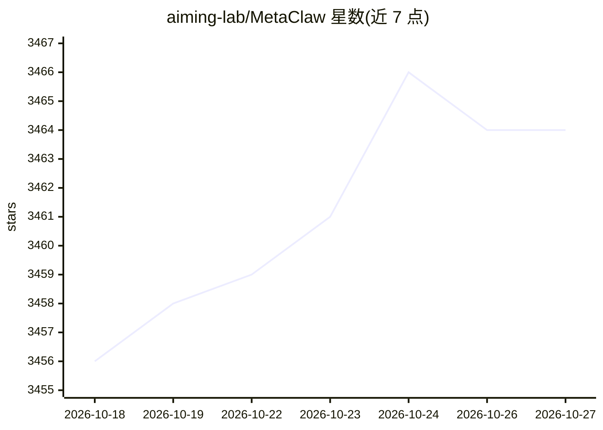

# aiming-lab/MetaClaw

⭐ 3,464 · Python · MIT · 推送 2026-06-07 · [GitHub](https://github.com/aiming-lab/MetaClaw) · [官网](https://arxiv.org/abs/2603.17187) · 组织维护 · 中文 README

**给个人 agent 接入的持续学习代理层：边对话边沉淀技能**

MetaClaw 以透明代理形式置于个人 agent（OpenClaw、CoPaw、IronClaw 等 8 种）与 OpenAI 兼容 LLM API 之间：每轮对话注入相关技能、会话结束自动总结为新技能，并可选启用基于 GRPO 的云端 LoRA 强化学习，权重更新调度在空闲/睡眠/日历会议窗口执行。支持跨会话长期记忆、三种运行模式（skills_only/rl/auto），无需本地 GPU。通过 pip 或 OpenClaw 一键插件安装，CLI 配置向导完成接入。

## 筛选速览

| 维度 | 判定 | 备注 |
|---|---|---|
| AI 角色 | `ai-ecosystem` | LLM/agent 周边工具 |
| 许可风险 | `permissive` | MIT |
| 部署形态 | `desktop` | 安装包/桌面程序 |
| 模型依赖 | — | README 未给出锁定关系 |
| 硬件要求 | `cpu-ok` | |
| 安装摩擦 | `low` | 无编译、无系统依赖或容器化 |
| 成熟度 | — | 结构信号不足 |

## 能力要点

- 透明代理拦截对话，每轮注入技能并自动总结新技能
- RL（GRPO）+ 智能调度：仅在空闲/睡眠/会议窗口更新权重
- 支持 OpenClaw/CoPaw/IronClaw/PicoClaw/ZeroClaw/NanoClaw/NemoClaw/Hermes 共 8 种 agent 自动接线
- 提供 /v1/messages Anthropic 兼容端点，无需 agent 侧改动

## 适用场景

- 让日常使用的个人 agent 从真实对话中持续积累技能
- 在不打扰使用的前提下对 agent 做云端 LoRA 强化学习
- 为 agent 增加跨会话长期记忆

## 场景标签

`Agent 记忆` `微调` `强化学习` · 领域:Agent 开发

## 证据(README 行号)

> L53: Under the hood, it places your model behind a proxy that intercepts interactions from your personal agent (OpenClaw

## 星数曲线

2026-10-18 3,456 → 2026-10-27 3,464（+8）

---
*卡片 v1 · prompt 1.4 · 生成 2026-10-20 · 置信度 mid · 依据 README sha `cd16b4392f2d` · [字段定义](../../DATASET.md)*
