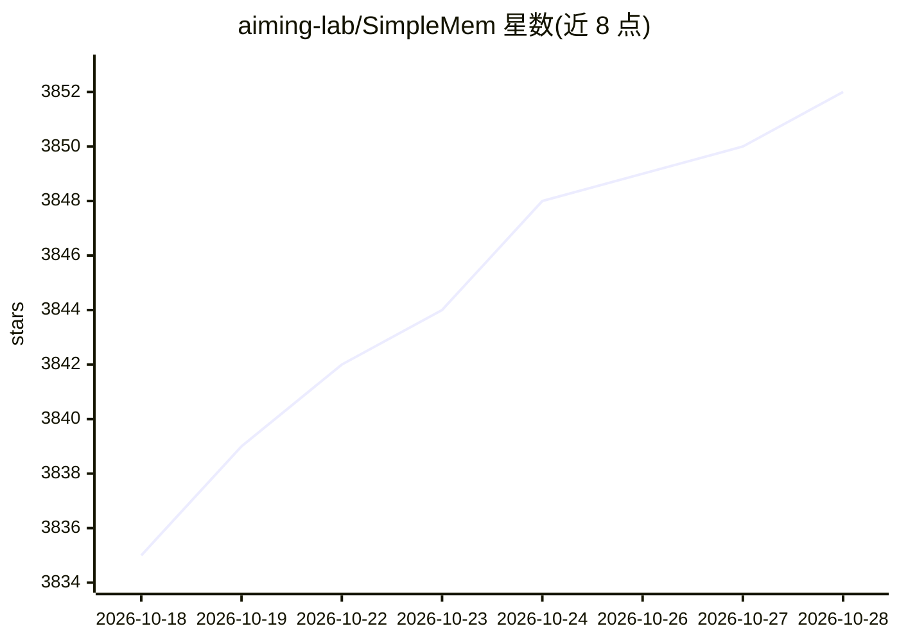

# aiming-lab/SimpleMem

⭐ 3,852 · Python · MIT · 推送 2026-07-24 · [GitHub](https://github.com/aiming-lab/SimpleMem) · 组织维护 · 中文 README

**给 LLM Agent 开发者的长期记忆库：存储、压缩、检索多模态记忆**

面向 LLM agent 的统一长期记忆栈，整合三项工作：SimpleMem 文本记忆（三阶段压缩流水线：语义结构化压缩、在线语义合成、意图感知检索规划）、Omni-SimpleMem 多模态记忆（文本/图像/音频/视频，选择性摄取、渐进式检索、知识图谱增强）与 EvolveMem 检索自进化（LLM 驱动的闭环调优）。单一 simplemem 包按首次调用自动路由后端，通过 OPENAI_BASE_URL 兼容任意 OpenAI 兼容端点（OpenAI/Qwen/Azure/Ollama 等），提供 MCP Server、Docker 部署、REST API 与 Web UI。运行需 Python 3.10+ 与 API key。

## 筛选速览

| 维度 | 判定 | 备注 |
|---|---|---|
| AI 角色 | `ai-ecosystem` | LLM/agent 周边工具 |
| 许可风险 | `permissive` | MIT |
| 部署形态 | `self-host` | docker 或自建部署 |
| 模型依赖 | local-ok | 支持本地模型 |
| 硬件要求 | — | 无带数字的原话,不猜 |
| 安装摩擦 | `low` | 无编译、无系统依赖或容器化 |
| 成熟度 | — | 结构信号不足 |

## 能力要点

- 三阶段文本记忆压缩：语义结构化压缩、在线语义合成、意图感知检索规划
- 多模态记忆支持文本、图像、音频、视频
- EvolveMem 通过 LLM 驱动闭环（评估→诊断→提案→守护）自进化检索配置
- 提供 MCP Server，可接入 Claude Desktop、Cursor、LM Studio 等 MCP 客户端

## 适用场景

- 让 LLM agent 跨会话记住并回忆历史对话与事实
- 为多模态 agent 构建文本/图像/音视频长期记忆
- 在自己的开发集上自动调优检索超参数
- 通过 MCP 接入 Claude Desktop 或 Cursor 等客户端获得记忆能力

## 场景标签

`Agent 记忆` `知识图谱` `多模态` · 领域:Agent 开发

## 证据(README 行号)

> L97: At a high level, SimpleMem works as a long-term memory system for LLM-based agents. The workflow consists of three 
> L170: **SimpleMem** is a unified memory stack for LLM agents, built on one principle: store *semantically lossless* memo
> L7:  Works with any AI platform that supports MCP (text memory) or Python integration (full multimodal)

## 星数曲线

2026-10-18 3,835 → 2026-10-28 3,852（+17）

---
*卡片 v1 · prompt 1.4 · 生成 2026-10-21 · 置信度 high · 依据 README sha `1a4e08fc7ad3` · [字段定义](../../DATASET.md)*
