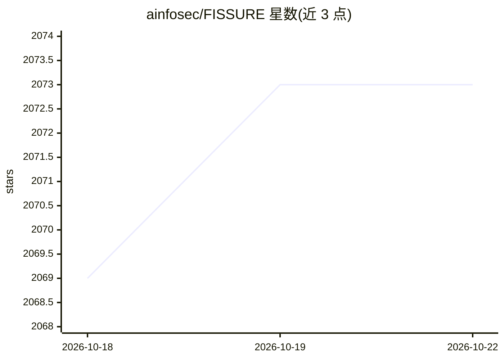

# ainfosec/FISSURE

⭐ 2,073 · Python · GPL-3.0 · 推送 2026-10-19 · [GitHub](https://github.com/ainfosec/FISSURE) · [官网](https://twitter.com/FissureRF) · 组织维护

**面向射频分析与逆向工程的开源 SDR 框架（含分布式节点）**

FISSURE 是开源的射频（RF）分析、自动化与分布式作业框架：将 SDR 硬件、信号处理、Sensor Nodes、地理定位、协议分析、目标管理与态势感知整合在一个可扩展环境中。底层 RF 处理由 GNU Radio 等工具提供，FISSURE 负责协调硬件、数据、插件与操作流程。支持单机工作站、分布式 Sensor Nodes、无界面 Hub 及 Apptainer 容器化部署，可通过 ATAK/WinTAK/TAK Server 共享目标与告警。面向操作人员、研究者、教育者与爱好者；Python3 分支为主，旧 Python2 分支已弃用，主要在 Ubuntu 环境测试。AI/ML 以集成接口形式出现，非本体核心。

## 筛选速览

| 维度 | 判定 | 备注 |
|---|---|---|
| AI 角色 | `ai-enhanced` | 去掉 AI 部分产品仍成立 |
| 许可风险 | `viral` | GPL-3.0 |
| 部署形态 | `desktop` | 安装包/桌面程序 |
| 模型依赖 | — | README 未给出锁定关系 |
| 硬件要求 | — | 无带数字的原话,不猜 |
| 安装摩擦 | `low` | 无编译、无系统依赖或容器化 |
| 成熟度 | `idea` | |

## 能力要点

- RF 信号检测、分类、捕获、分析与 IQ 数据回放
- 单机或跨 IP 网络的分布式 Sensor Nodes 协调与多节点地理定位
- 插件/Actions 机制在不修改核心的情况下扩展能力
- 通过 ATAK/WinTAK/TAK Server 共享态势、目标与告警

## 适用场景

- 用 SDR 硬件进行信号调查、捕获与协议逆向分析
- 分布式部署多个 Sensor Node 做射频监测与辐射源定位
- 教学场景中讲授 SDR、DSP、无线安全与逆向工程
- 对协议实现做模糊测试与漏洞分析

## 场景标签

`网络安全` · 领域:学习与行业

## 证据(README 行号)

> L33: FISSURE is an **open-source framework for RF analysis, automation, and distributed operations**. It connects SDR ha
> L77: - Integrate custom analysis, external tools, and emerging AI/ML capabilities
> L126: - **Automation, Provenance & AI/ML:** Strengthen traceable execution, structured context, workflow automation, and

## 星数曲线

2026-10-18 2,069 → 2026-10-22 2,073（+4）

---
*卡片 v1 · prompt 1.4 · 生成 2026-10-21 · 置信度 high · 依据 README sha `abab69835f8e` · [字段定义](../../DATASET.md)*
