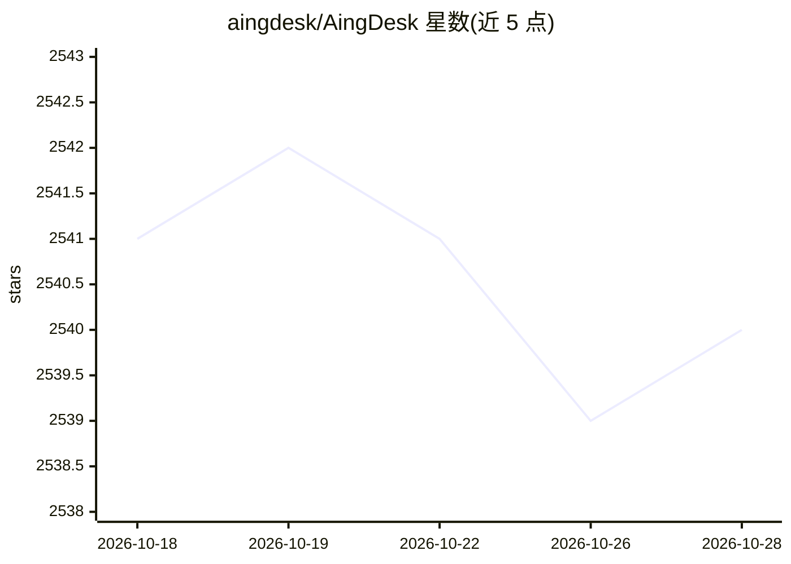

# aingdesk/AingDesk

⭐ 2,540 · TypeScript · MIT · 推送 2026-06-04 · [GitHub](https://github.com/aingdesk/AingDesk) · [官网](https://www.aingdesk.com) · 组织维护 · 中文 README

**面向普通用户的 AI 助手：本地模型/知识库/智能体/联网搜索**

基于 Electron/Node.js 的 AI 助手软件，面向终端用户：支持一键部署本地 AI 模型或接入主流模型 API，可搭建本地知识库、创建智能体、联网搜索，并支持 MCP Client 与在线分享给他人使用；同时提供客户端版（macOS/Windows 官网或 GitHub 下载安装包）与服务端 Docker 部署两种形态，也可从源码构建。多模型同会话对话标注为 coming soon，README 自述产品仍在快速成长中。

## 筛选速览

| 维度 | 判定 | 备注 |
|---|---|---|
| AI 角色 | `ai-native` | 本体是模型或模型工具 |
| 许可风险 | `permissive` | MIT |
| 部署形态 | `self-host` | docker 或自建部署 |
| 模型依赖 | — | README 未给出锁定关系 |
| 硬件要求 | — | 无带数字的原话,不猜 |
| 安装摩擦 | `low` | 无编译、无系统依赖或容器化 |
| 成熟度 | `idea` | |

## 能力要点

- 一键部署本地 AI 模型与主流模型 API 接入
- 本地知识库与智能体创建
- 支持 MCP Client 与联网搜索
- 可在线分享给他人使用；提供客户端版与服务端 Docker 部署

## 适用场景

- 在桌面上一站式使用本地或 API 模型的 AI 对话助手
- 搭建个人本地知识库进行问答
- 创建智能体并分享给他人在线使用

## 场景标签

`AI 助手` `知识库管理` · 领域:对话与助手

## 证据(README 行号)

> L13: AingDesk是一款简单好用的AI助手，支持知识库、模型API、分享、联网搜索、智能体，它还在飞快成长中。
> L19: A user-friendly AI assistant software that supports local AI models, APIs, and knowledge base setup.
> L23: - One-click deployment of local AI models and mainstream model APIs

## 星数曲线

2026-10-18 2,541 → 2026-10-28 2,540（-1）

---
*卡片 v1 · prompt 1.4 · 生成 2026-10-21 · 置信度 high · 依据 README sha `f30929dbbf14` · [字段定义](../../DATASET.md)*
