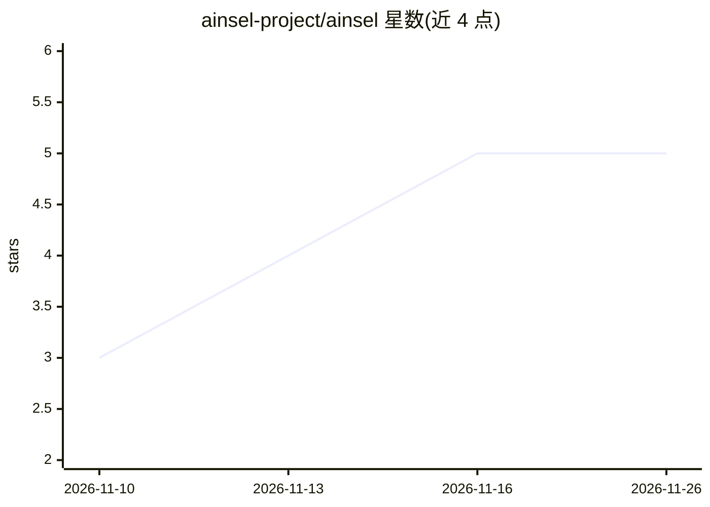

# ainsel-project/ainsel

⭐ 5 · Go · Apache-2.0 · 推送 2026-11-25 · [GitHub](https://github.com/ainsel-project/ainsel) · [官网](https://ainsel-project.github.io/ainsel/) · 组织维护

**Kubernetes-native AI agent 编排平台：事件触发 agent 响应**

AInsel 是部署在 Kubernetes 上的 agent 编排平台：Webhook、cron、控制台聊天等事件经连接器进入队列，由触发器匹配并唤醒配置好的 agent（模型、persona、技能、工具与 MCP 服务器的组合），agent 通过工具对源系统作出回应，如 PR 评审评论、issue 打标、直接开 PR。Agent、连接器、运行时镜像以 CRD 定义，由单个 Helm chart 部署；管理员集中管理模型、提示词与预算，支持基于队列的自动伸缩、访问控制、网络策略与逐次调用的成本追踪。

## 筛选速览

| 维度 | 判定 | 备注 |
|---|---|---|
| AI 角色 | `ai-ecosystem` | LLM/agent 周边工具 |
| 许可风险 | `permissive` | Apache-2.0 |
| 部署形态 | `library` | 以包/库形式分发 |
| 模型依赖 | local-ok | 支持本地模型 |
| 硬件要求 | — | 无带数字的原话,不猜 |
| 安装摩擦 | `low` | 无编译、无系统依赖或容器化 |
| 成熟度 | — | 结构信号不足 |

## 能力要点

- 事件→触发器→agent→回写的统一运行循环，支持 Forgejo/GitHub webhook 与 cron
- Agent/连接器/运行时镜像以 Kubernetes CRD 定义，单个 Helm chart 部署
- PostgreSQL 队列、重试语义、按队列压力伸缩至零副本
- 自托管：支持 Ollama 或任意 OpenAI 兼容端点，逐次调用成本追踪

## 适用场景

- 对仓库新开 PR 自动做文件级评审并回复
- 对 issue 自动分类、打标并回答评论中的提问
- 带标签的 issue 自动分支、实现改动并开 PR
- 通过 webhook 接入家庭自动化或 CI 告警并让 agent 处理

## 场景标签

`代码审查` `Agent 框架` · 领域:Agent 开发

## 证据(README 行号)

> L19: **AInsel is a Kubernetes-native agent orchestrator: events go in, your AI
> L131: An **agent** is an AI worker — model, persona, skills, tools, and MCP
> L40: - **Real ops.** Agents, connectors, and runtime images are Kubernetes

## 星数曲线

2026-11-10 3 → 2026-11-26 5（+2）

---
*卡片 v1 · prompt 1.4 · 生成 2026-11-21 · 置信度 high · 依据 README sha `5f5c5ed4e3e6` · [字段定义](../../DATASET.md)*
