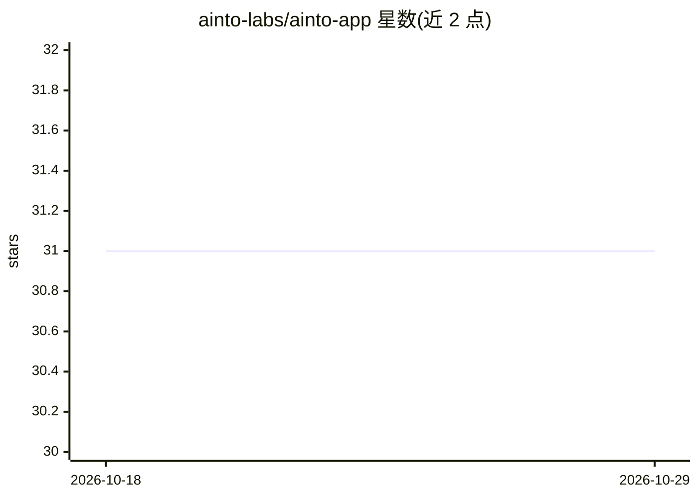

# ainto-labs/ainto-app

⭐ 31 · Swift · GPL-3.0 · 推送 2026-09-18 · [GitHub](https://github.com/ainto-labs/ainto-app) · [官网](https://ainto.app) · 组织维护 · 中文 README

**macOS 原生启动器：应用搜索、剪贴板历史、文本扩展与内置 AI 命令**

面向工程师的 macOS 桌面启动器，用 Swift（AppKit + SwiftUI）前端与 Rust 核心（C ABI 桥接、静态库链接）实现，无 Electron 与 web view。功能包括模糊应用搜索与启动（frecency 排序）、持久化剪贴板历史（SQLite 存储、XXH3 去重、图片落盘引用路径）、任意应用内的文本扩展（支持 {date}/{clipboard} 等动态占位符）。AI 命令通过在本机调用 Claude Code CLI（claude -p）实现选中文本的修正/翻译/摘要，用量计入用户自己的 Claude 账户，Ainto 不存 API key。数据本地存放于 ~/.config/ainto/，声明无遥测。提供签名公证的 dmg 下载，构建需 macOS 14.0+、Xcode 15+ 与 Rust 工具链。

## 筛选速览

| 维度 | 判定 | 备注 |
|---|---|---|
| AI 角色 | `ai-enhanced` | 去掉 AI 部分产品仍成立 |
| 许可风险 | `viral` | GPL-3.0 |
| 部署形态 | `desktop` | 安装包/桌面程序 |
| 模型依赖 | — | README 未给出锁定关系 |
| 硬件要求 | — | 无带数字的原话,不猜 |
| 安装摩擦 | `low` | 无编译、无系统依赖或容器化 |
| 成熟度 | — | 结构信号不足 |

## 能力要点

- Rust 核心单库承载搜索/剪贴板/文本扩展/AI 命令
- 剪贴板历史 SQLite 持久化，XXH3 内容哈希去重，文本与图片独立保留上限
- AI 命令经本机 Claude Code CLI 运行，不存 API key
- 本地优先：数据均在 ~/.config/ainto/，声明无遥测

## 适用场景

- 用全局热键快速搜索并启动 macOS 应用
- 随时调取并搜索历史剪贴板内容（文本/图片/文件）
- 在任意应用中用关键词做文本扩展
- 对选中文本执行语法修正、翻译、摘要等 AI 操作

## 场景标签

`AI 写作` · 领域:内容生成

## 证据(README 行号)

> L23: |**AI**|Press Tab to chat, or select text → run & replace (Fix Grammar, Translate, Summarize, or your own)|
> L28: > **AI & billing:** Ainto runs the Claude Code CLI on your Mac (`claude -p`), so AI usage is billed to your own Cla
> L32: Ainto is a native macOS app: an AppKit + SwiftUI front end over a Rust core, bridged through a C ABI. No Electron, 

## 星数曲线

2026-10-18 31 → 2026-10-29 31（+0）

---
*卡片 v1 · prompt 1.4 · 生成 2026-10-26 · 置信度 high · 依据 README sha `935f985e97bb` · [字段定义](../../DATASET.md)*
