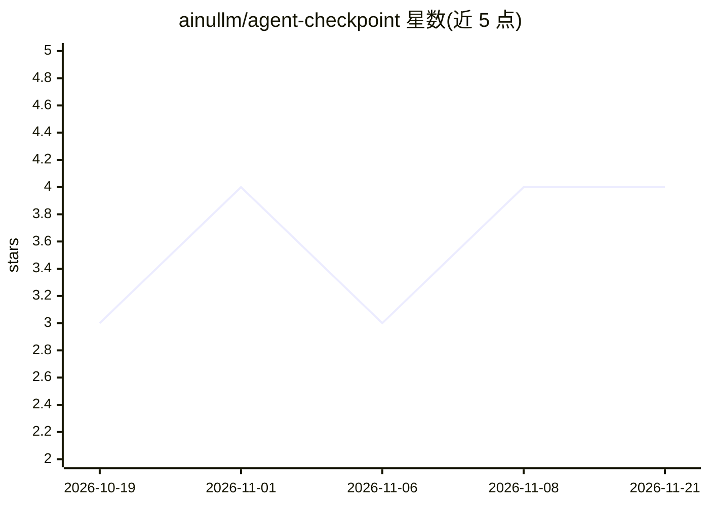

# ainullm/agent-checkpoint

⭐ 4 · MIT · 推送 2026-10-08 · [GitHub](https://github.com/ainullm/agent-checkpoint) · 个人维护

**为 AI 编码代理提供零数据丢失文件快照与选择性回滚的规则集**

以规则文件（.cursorrules/CLAUDE.md/AGENTS.md 等）形式分发的协议：AI 编码代理在修改文件前先将原文件复制到 .snapshots/ 目录实现零数据丢失，按 SemVer 分类版本、每个文件保留最多 5 个快照的分片清单将 token 开销降低约 80%，并通过 REVISION_LOG.md 追加式记录审计日志。支持选择性回滚并附带哈希校验脚本。安装方式为复制适配器文件或 curl 单行下载，零配置、零依赖、无 CLI 命令。面向使用 Cursor、Claude Code、Cline、Windsurf、Antigravity、GitHub Copilot 等代理的开发者。

## 筛选速览

| 维度 | 判定 | 备注 |
|---|---|---|
| AI 角色 | `ai-enhanced` | 去掉 AI 部分产品仍成立 |
| 许可风险 | `permissive` | MIT |
| 部署形态 | `desktop` | 安装包/桌面程序 |
| 模型依赖 | — | README 未给出锁定关系 |
| 硬件要求 | — | 无带数字的原话,不猜 |
| 安装摩擦 | `low` | 无编译、无系统依赖或容器化 |
| 成熟度 | — | 结构信号不足 |

## 能力要点

- 编辑前快照机制保证工作代码不永久丢失
- 每文件隔离目录 + 滑动窗口保留最多 5 个版本
- 分片本地清单 O(1) token 开销，声明较朴素方案降 80%
- 选择性回滚与 SHA256 双侧完整性验证

## 适用场景

- AI 代理自主重构后只需回滚出错的那个文件
- 防止代理原地覆盖丢失关键函数与边界情况
- 为团队保留可提交的简洁变更日志

## 场景标签

`编码 Agent` · 领域:编码与开发

## 证据(README 行号)

> L26: **Agent-Checkpoint v2.0** solves both problems with an ultra-lightweight, zero-dependency protocol. It enforces pre
> L56: Installation requires **zero configuration and no command-line tools**. It follows a simple drop-in pattern.
> L61:  * **Cursor IDE:** Copy `.cursorrules` to project root, or copy `agent-checkpoint.mdc` into `.cursor/rules/` (Curso

## 星数曲线

2026-10-19 3 → 2026-11-21 4（+1）

---
*卡片 v1 · prompt 1.4 · 生成 2026-11-21 · 置信度 mid · 依据 README sha `82c0cc3a88bd` · [字段定义](../../DATASET.md)*
