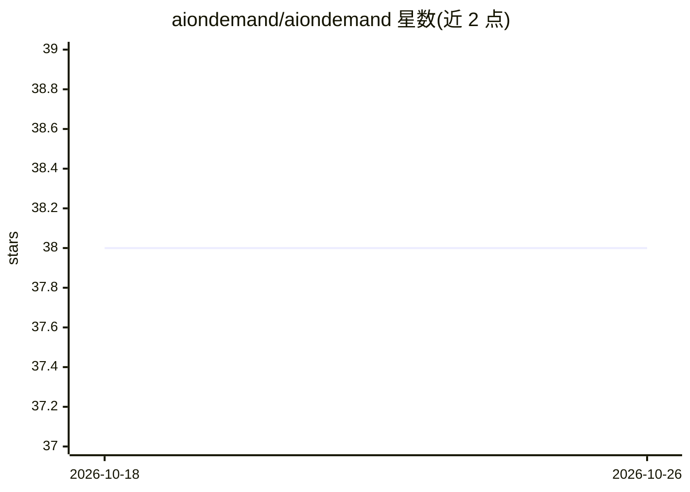

# aiondemand/aiondemand

⭐ 38 · Python · MIT · 推送 2026-05-26 · [GitHub](https://github.com/aiondemand/aiondemand) · [官网](https://aiondemand.github.io/aiondemand/) · 组织维护

**AI 资源获取与共享 SDK：字符串 ID 实例化模型、检索元数据目录**

Python SDK，两大功能：一是通过字符串 ID 快速实例化 AI 模型对象，覆盖 scikit-learn、xgboost、lightgbm、sktime、skpro 等已索引库，支持 Pipeline 等复合结构，缺失依赖时报错提示；二是跨平台元数据目录检索，按 Python API 访问数据集、论文等资产端点，返回 Pandas dataframe 或 JSON，支持 elastic search 查询。面向科研与开发者，由欧盟 Horizon Europe 资助的 AI4EUROPE 项目开发。市场分享功能与网页编辑器仍在开发中。

## 筛选速览

| 维度 | 判定 | 备注 |
|---|---|---|
| AI 角色 | `ai-ecosystem` | LLM/agent 周边工具 |
| 许可风险 | `permissive` | MIT |
| 部署形态 | `library` | 以包/库形式分发 |
| 模型依赖 | — | README 未给出锁定关系 |
| 硬件要求 | — | 无带数字的原话,不猜 |
| 安装摩擦 | `low` | 无编译、无系统依赖或容器化 |
| 成熟度 | `idea` | |

## 能力要点

- 字符串 ID 跨生态实例化模型对象，依赖缺失时给出提示
- 已索引 scikit-learn 系、sktime、skpro 等十余个库，范围持续扩展
- 跨平台元数据目录检索数据集、论文，支持 elastic search

## 适用场景

- 用字符串规格快速构造机器学习模型与 Pipeline，免写 import
- 检索跨平台 AI 数据集与论文元数据
- 以易分享的字符串形式传递模型规格

## 场景标签

 · 领域:AI 基础设施/元数据目录

## 证据(README 行号)

> L3: * quick instantiation of AI models from string IDs across the ecosystem
> L4: * cross-platform metadata catalogue for papers, projects, datasets, models
> L103: You can directly access endpoints through the Python API, for example to browse datasets:

## 星数曲线

2026-10-18 38 → 2026-10-26 38（+0）

---
*卡片 v1 · prompt 1.4 · 生成 2026-10-25 · 置信度 high · 依据 README sha `f0f0c8f1e291` · [字段定义](../../DATASET.md)*
