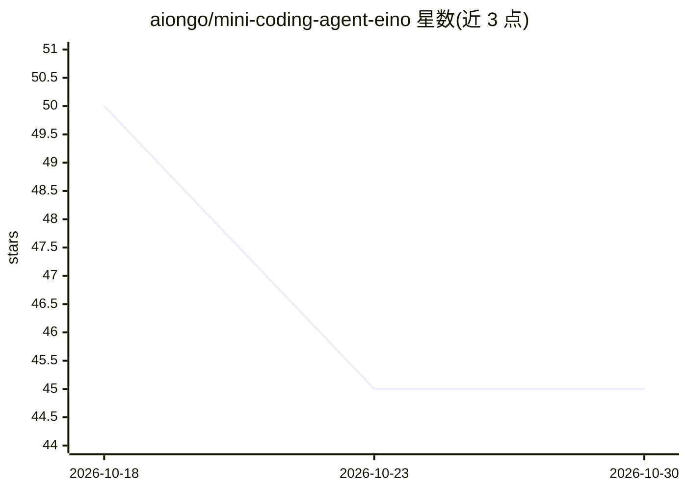

# aiongo/mini-coding-agent-eino

⭐ 45 · Go · MIT · 推送 2026-08-25 · [GitHub](https://github.com/aiongo/mini-coding-agent-eino) · 个人维护 · 中文 README

**基于 eino 框架的本地极简编码 agent（Go CLI）**

用 Go 编写的本地编码 agent CLI，基于 CloudWeGo eino 框架的 adk ChatModelAgent 与原生 tool-calling 重建 Sebastian Raschka 的 Python mini-coding-agent。功能含工作区快照收集、结构化工具、风险工具审批门（ask/auto/never）、会话与记忆持久化、有界子代理委派、python_execute 工具。模型后端为本地 Ollama（模型须支持 tool calling），需 Go 1.27+，git clone 后 go build 或 go install 运行。定位为教学/可读性优先的小型实现，非健壮性优先。

## 筛选速览

| 维度 | 判定 | 备注 |
|---|---|---|
| AI 角色 | `ai-native` | 本体是模型或模型工具 |
| 许可风险 | `permissive` | MIT |
| 部署形态 | `library` | 以包/库形式分发 |
| 模型依赖 | local-ok | 支持本地模型 |
| 硬件要求 | — | 无带数字的原话,不猜 |
| 安装摩擦 | `low` | 无编译、无系统依赖或容器化 |
| 成熟度 | — | 结构信号不足 |

## 能力要点

- eino adk ChatModelAgent 驱动 ReAct 循环，原生 tool-calling
- 风险工具审批门与会话/工作记忆持久化、断点恢复
- 7 个结构化工具与有界子代理委派
- 模型后端为本地 Ollama，任何支持 tool calling 的模型均可

## 适用场景

- 在本地仓库里跑一个可审批的编码 agent 完成检查/修改任务
- 学习编码 agent 的六组件结构（上下文、提示、工具、会话等）
- 对比框架（eino）与无框架两种 agent 实现方式

## 场景标签

`编码 Agent` · 领域:编码与开发

## 证据(README 行号)

> L7: **A minimal local coding agent built on the
> L20: This repo contains a small standalone coding agent:
> L34: The model backend is currently based on Ollama.

## 星数曲线

2026-10-18 50 → 2026-10-30 45（-5）

---
*卡片 v1 · prompt 1.4 · 生成 2026-10-25 · 置信度 high · 依据 README sha `b90e0acaf256` · [字段定义](../../DATASET.md)*
