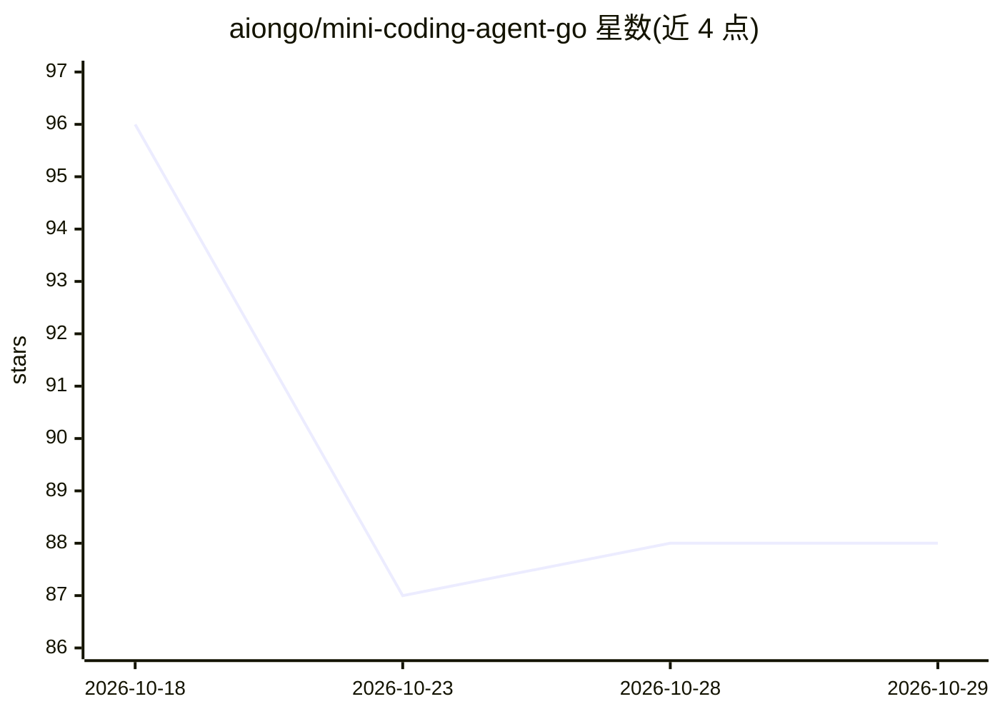

# aiongo/mini-coding-agent-go

⭐ 88 · Go · MIT · 推送 2026-08-25 · [GitHub](https://github.com/aiongo/mini-coding-agent-go) · 个人维护 · 中文 README

**Go 编写的极简本地编程 agent，Ollama 后端，无 LLM 框架**

Sebastian Raschka mini-coding-agent 的 Go 移植，单个 main 包加 CLI。实现本地 agent 循环：工作区快照收集、稳定提示词与轮次状态、结构化工具（七个）与风险工具审批门、会话转录与记忆持久化、有界子代理委派。模型后端基于 Ollama 的 /api/generate 原生接口（resty 调用，无 SDK/框架），通过 <tool>/<final> 文本协议驱动。提供 REPL 与一次性 prompt 子命令、会话恢复、审批三模式。需 Go 1.27+ 与本地 Ollama；作者声明以可读性优先而非健壮性。

## 筛选速览

| 维度 | 判定 | 备注 |
|---|---|---|
| AI 角色 | `ai-native` | 本体是模型或模型工具 |
| 许可风险 | `permissive` | MIT |
| 部署形态 | `library` | 以包/库形式分发 |
| 模型依赖 | local-ok | 支持本地模型 |
| 硬件要求 | — | 无带数字的原话,不猜 |
| 安装摩擦 | `low` | 无编译、无系统依赖或容器化 |
| 成熟度 | — | 结构信号不足 |

## 能力要点

- 六大组件：仓库上下文、提示缓存复用、结构化工具与审批、上下文缩减、转录/记忆持久化、有界委派
- 直接调用 Ollama /api/generate，无 LLM 框架与 SDK
- 七种工具、REPL 斜杠命令、会话恢复与工作记忆
- 风险操作（shell/写文件）三档审批：ask/auto/never

## 适用场景

- 在本地通过对话让 agent 检查、修改代码仓库
- 学习 coding agent 的内部构造（跟随原作组件式教程）
- 在受控审批模式下自动化执行小型编码任务

## 场景标签

`编码 Agent` `教程课程` · 领域:编码与开发

## 证据(README 行号)

> L18: This repo contains a small standalone coding agent:
> L23: It is a minimal local agent loop with:
> L32: The model backend is currently based on Ollama.

## 星数曲线

2026-10-18 96 → 2026-10-29 88（-8）

---
*卡片 v1 · prompt 1.4 · 生成 2026-10-23 · 置信度 high · 依据 README sha `c5c6129b8c3d` · [字段定义](../../DATASET.md)*
