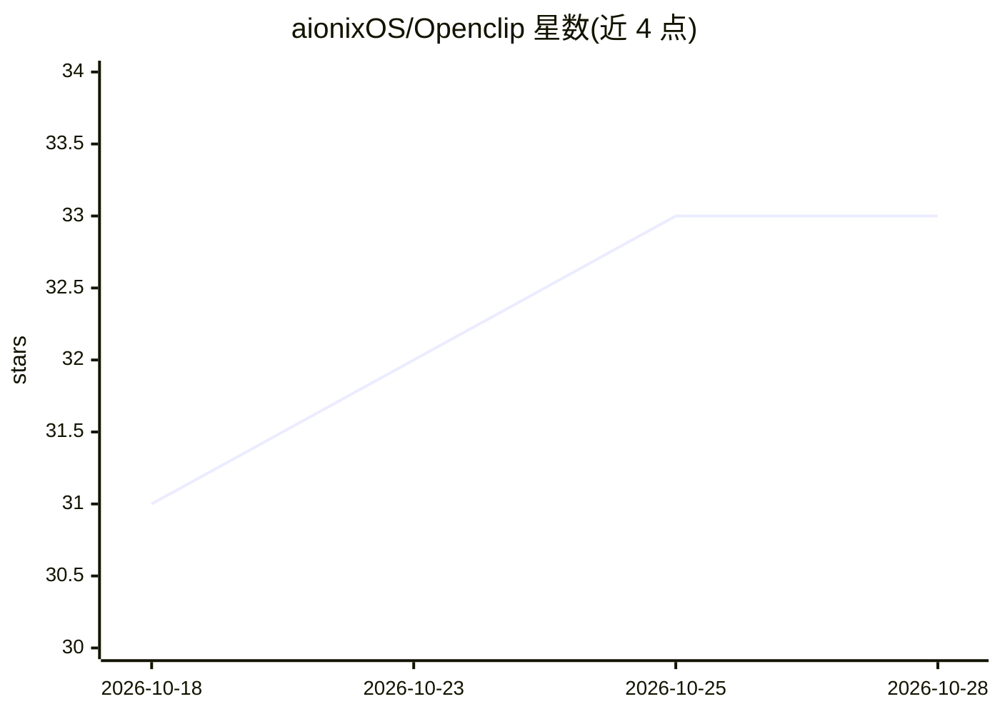

# aionixOS/Openclip

⭐ 35 · HTML · MIT · 推送 2026-10-01 · [GitHub](https://github.com/aionixOS/Openclip) · 个人维护

**本地自托管工具：粘贴 YouTube 链接自动生成短视频切片**

本地优先的开源视频切片引擎：粘贴 YouTube URL 后经 yt-dlp 下载，提取字幕（手动→自动→Whisper），调用 LLM 做病毒式钩子检测，结合 FFmpeg 音频 RMS 活跃说话人追踪与 MediaPipe 人脸追踪，自动剪辑并渲染 9:16 竖屏短片，项目与切片元数据存入 SQLite。架构为 FastAPI 后端加 Next.js 前端，通过 WebSocket 推送实时进度。需自备 LLM 提供商的 API key，FFmpeg 须单独安装。作者自述项目刚起步，部分路线图功能仍在开发。

## 筛选速览

| 维度 | 判定 | 备注 |
|---|---|---|
| AI 角色 | `ai-native` | 本体是模型或模型工具 |
| 许可风险 | `permissive` | MIT |
| 部署形态 | `None` |  |
| 模型依赖 | — | README 未给出锁定关系 |
| 硬件要求 | — | 无带数字的原话,不猜 |
| 安装摩擦 | `medium` | 含编译或系统依赖之一 |
| 成熟度 | `idea` | |

## 能力要点

- LLM 驱动的病毒式钩子检测与智能布局识别（Tutorial/Podcast/Panel/Single/None）
- FFmpeg 音频 RMS 活跃说话人追踪 + MediaPipe 人脸追踪自动剪成 9:16 切片
- 全流程本地运行，数据仅存本机（视频在 /tmp，数据库为 SQLite）
- FastAPI + WebSocket 实时进度，提供 API 文档端点

## 适用场景

- 把长视频或播客自动剪成适合 Shorts/TikTok 的竖屏切片
- 不订阅付费剪辑服务、在自己电脑上完成视频切片
- 通过 API 批量创建并跟踪视频切片项目

## 场景标签

`图像视频处理` · 领域:感知与多模态

## 证据(README 行号)

> L31: OpenClip is a **free, open-source, local-first** alternative to paid video clipping tools like OpusClip, Vidyo.ai, 
> L108: ✅ AI-driven viral hook detection (LLM)
> L111: ✅ Auto-cut and face-track into 9:16 clips (FFmpeg filter_complex + MediaPipe)

## 星数曲线

2026-10-18 31 → 2026-10-28 33（+2）

---
*卡片 v1 · prompt 1.4 · 生成 2026-10-25 · 置信度 high · 依据 README sha `834bb0686ad1` · [字段定义](../../DATASET.md)*
