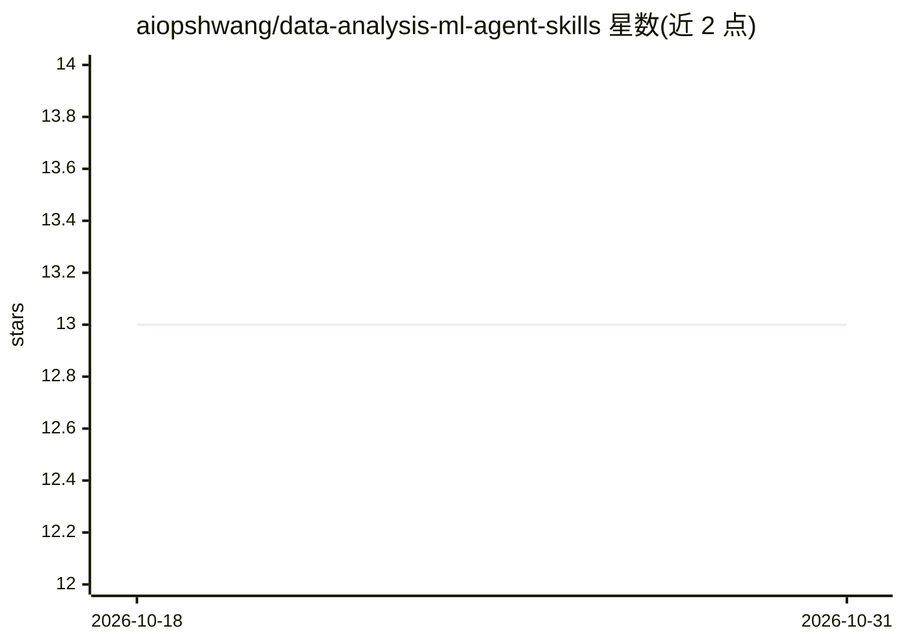

# aiopshwang/data-analysis-ml-agent-skills

⭐ 13 · Python · MIT · 推送 2026-08-27 · [GitHub](https://github.com/aiopshwang/data-analysis-ml-agent-skills) · [官网](https://aiopshwang.github.io/data-analysis-ml-agent-skills/) · 个人维护

**面向编码 agent 的数据科学方法论技能套件（7 个技能）**

由 aiopshwang 维护的开源 Agent Skills 套件：1 个路由器、1 个生命周期编排器和 5 个专家技能（数据与真值审计、防泄漏实验设计、模型与声明验证、ML 失败诊断、可复现交付），为编码 agent 提供“决策契约→审计→基线→对照实验→独立验证→诊断→洁净室复现”的操作纪律。通过 GitHub CLI、Agent Skills CLI（npx）或手动 git clone 安装到 Codex、Claude Code、Cursor、GitHub Copilot、Gemini CLI 等宿主。仓库自带 manifest/链接/触发词覆盖等静态校验脚本与 pytest 测试；README 声明其非 AutoML 框架、不保证模型性能。

## 筛选速览

| 维度 | 判定 | 备注 |
|---|---|---|
| AI 角色 | `ai-knowledge` | 知识聚合/清单类 |
| 许可风险 | `permissive` | MIT |
| 部署形态 | `library` | 以包/库形式分发 |
| 模型依赖 | — | README 未给出锁定关系 |
| 硬件要求 | — | 无带数字的原话,不猜 |
| 安装摩擦 | `low` | 无编译、无系统依赖或容器化 |
| 成熟度 | — | 结构信号不足 |

## 能力要点

- 7 个技能：路由器 + 生命周期编排器 + 5 个专家阶段
- 防泄漏实验设计与独立验证等操作纪律内置于技能指令
- 附带 Claude Code 与 Codex 的插件 manifest（.claude-plugin / .codex-plugin）
- 仓库提供 validate_repo.py / scan_public.py 校验脚本与触发词测试集

## 适用场景

- 让编码 agent 在建模前先审计数据粒度、连接与真值可靠性
- 为模糊的数据科学需求生成决策级、可复现的完整流程
- 检查报告中的结论是否有同范围的证据支撑
- 准备可独立复现的洁净室交付与交接

## 场景标签

`数据分析` · 领域:效率与自动化

## 证据(README 行号)

> L11: Seven skills — a router, a lifecycle orchestrator, and five specialists — that teach coding agents to preserve the 
> L31: One router picks the right entry, one orchestrator runs the full lifecycle, and five specialists own its stages:

## 星数曲线

2026-10-18 13 → 2026-10-31 13（+0）

---
*卡片 v1 · prompt 1.4 · 生成 2026-10-31 · 置信度 mid · 依据 README sha `ced156273e09` · [字段定义](../../DATASET.md)*
