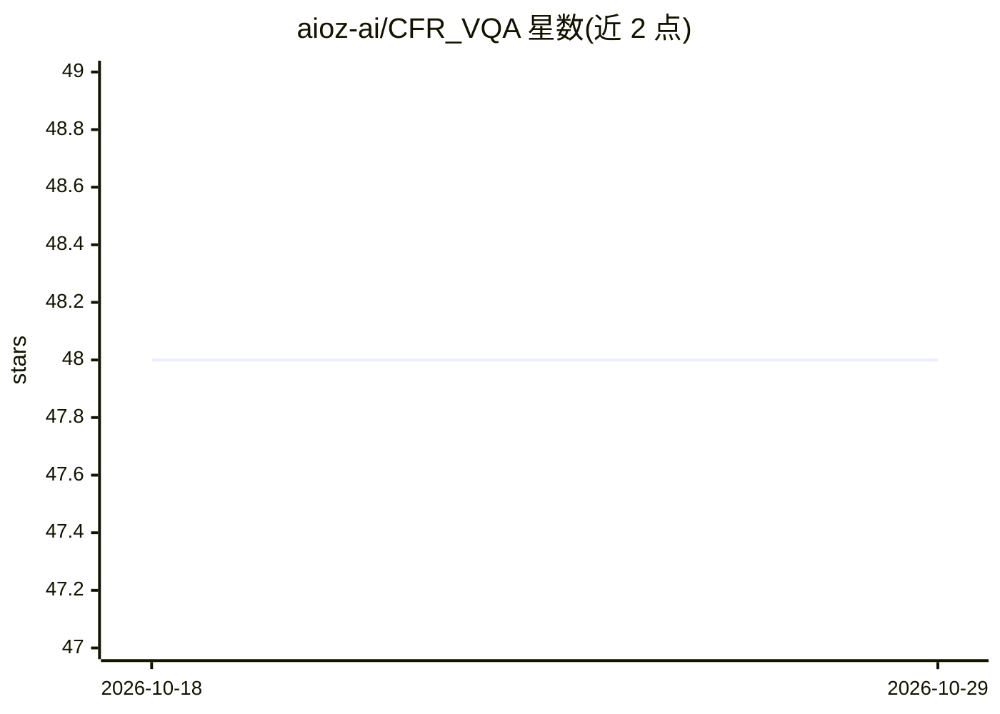

# aioz-ai/CFR_VQA

⭐ 48 · Python · MIT · 推送 2026-04-22 · [GitHub](https://github.com/aioz-ai/CFR_VQA) · 组织维护

**CVPRW'22 论文官方实现：由粗到细推理的视觉问答框架**

论文《Coarse-to-Fine Reasoning for Visual Question Answering》的官方代码实现，提出由粗到细的推理框架，联合学习图像与问题中提取的特征和谓词，用于视觉问答任务。在 GQA 等大规模 VQA 数据集上训练与测试，可集成 LXMERT 预训练模型，并提供在 GQA 上预训练的权重。基于 Python 3.6 与 CUDA 9.2，通过 requirements.txt 安装依赖，运行 train.sh/test.sh 完成训练与测试。

## 筛选速览

| 维度 | 判定 | 备注 |
|---|---|---|
| AI 角色 | `ai-native` | 本体是模型或模型工具 |
| 许可风险 | `permissive` | MIT |
| 部署形态 | `library` | 以包/库形式分发 |
| 模型依赖 | — | README 未给出锁定关系 |
| 硬件要求 | — | 无带数字的原话,不猜 |
| 安装摩擦 | `medium` | 含编译或系统依赖之一 |
| 成熟度 | — | 结构信号不足 |

## 能力要点

- 由粗到细联合学习特征与谓词的 VQA 推理框架
- 支持集成 LXMERT 预训练模型（GQA 验证集 75.86%）
- 提供 GQA 数据集上的预训练权重与测试脚本

## 适用场景

- 复现论文在 GQA 数据集上的视觉问答结果
- 基于 CFR 框架做视觉问答研究或二次开发

## 场景标签

 · 领域:计算机视觉/多模态推理

## 证据(README 行号)

> L1: # Coarse-to-Fine Reasoning for Visual Question Answering
> L8: This repository is the implementation of `Coarse-to-Fine Reasoning Framework (CFR)` for the visual question answerin

## 星数曲线

2026-10-18 48 → 2026-10-29 48（+0）

---
*卡片 v1 · prompt 1.4 · 生成 2026-10-25 · 置信度 high · 依据 README sha `aa3f2ba091c3` · [字段定义](../../DATASET.md)*
