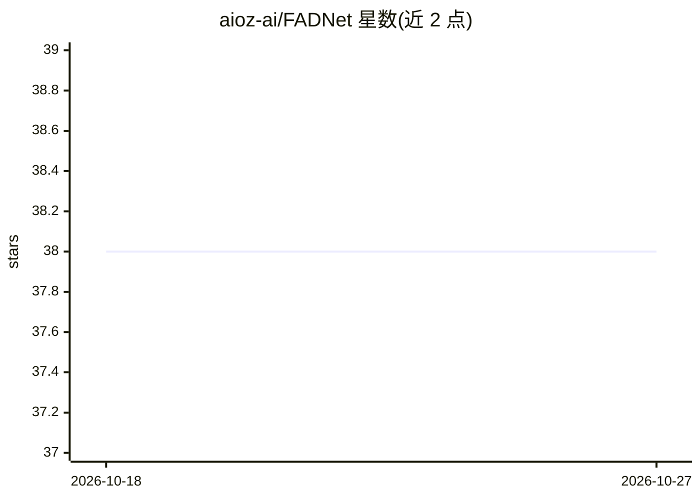

# aioz-ai/FADNet

⭐ 38 · Python · MIT · 推送 2026-04-21 · [GitHub](https://github.com/aioz-ai/FADNet) · [官网](https://ai.aioz.io/research/FADNet1/) · 组织维护

**IV'22 论文官方实现：联邦学习训练自动驾驶转向网络**

AIOZ AI 发布的 Deep Federated Learning for Autonomous Driving（IEEE IV 2022）论文代码实现：提出对等、去中心化的深度联邦学习（DFL）方法，在无需中央服务器的前提下训练自动驾驶策略网络 FADNet，处理数据分布不均衡问题。在 GAZEBO、CARLA（另提及 Udacity）三个公开数据集上评测，提供网络拓扑生成、训练与测试脚本及 GAZEBO 预训练模型。要求 Python 3.6 与 CUDA 9.2，基于他人联邦学习代码修改。

## 筛选速览

| 维度 | 判定 | 备注 |
|---|---|---|
| AI 角色 | `ai-native` | 本体是模型或模型工具 |
| 许可风险 | `permissive` | MIT |
| 部署形态 | `library` | 以包/库形式分发 |
| 模型依赖 | — | README 未给出锁定关系 |
| 硬件要求 | — | 无带数字的原话,不猜 |
| 安装摩擦 | `medium` | 含编译或系统依赖之一 |
| 成熟度 | — | 结构信号不足 |

## 能力要点

- 对等去中心化的深度联邦学习训练方案
- FADNet 网络结构，面向数据分布不均衡场景
- 提供 GAZEBO/CARLA 数据集的网络生成、训练与测试脚本
- 提供 GAZEBO 训练的预训练模型

## 适用场景

- 复现 IV'22 论文的联邦自动驾驶实验
- 在 GAZEBO/CARLA 数据上训练与评测自动驾驶策略
- 研究去中心化联邦学习在驾驶任务中的应用

## 场景标签

`模型训练` · 领域:训练与推理

## 证据(README 行号)

> L1: # Deep Federated Learning for Autonomous Driving
> L8: This repository is the implementation of a decentralized federated learning approach for Autonomous Driving. We benc

## 星数曲线

2026-10-18 38 → 2026-10-27 38（+0）

---
*卡片 v1 · prompt 1.4 · 生成 2026-10-25 · 置信度 high · 依据 README sha `657f49a9e9d3` · [字段定义](../../DATASET.md)*
