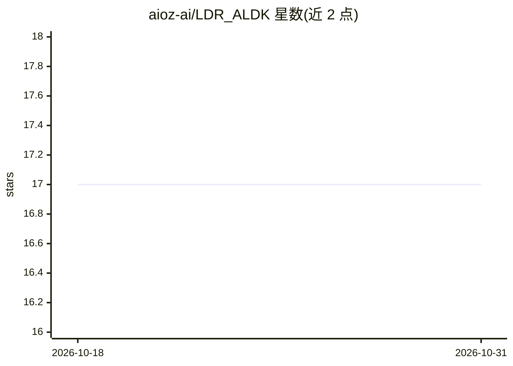

# aioz-ai/LDR_ALDK

⭐ 17 · Python · 推送 2026-04-22 · [GitHub](https://github.com/aioz-ai/LDR_ALDK) · [官网](https://blog.ai.aioz.io/research/ldr-aldk/) · 组织维护

**医学图像可变形配准的轻量网络及其训练评估代码**

论文配套官方实现（IEEE TMI 2021）：提出轻量可变形配准网络 LDR，通过对抗学习结合知识蒸馏（ALDK）将教师网络的信息传递给学生网络，学生网络设计为可部署于 CPU。README 提供 Python 3 环境下 pip 安装依赖、肝脏与脑部数据集准备、教师形变文件下载，以及 train.py / eval.py 的训练与评估命令示例。许可为 MIT。

## 筛选速览

| 维度 | 判定 | 备注 |
|---|---|---|
| AI 角色 | `ai-native` | 本体是模型或模型工具 |
| 许可风险 | `none` | — |
| 部署形态 | `desktop` | 安装包/桌面程序 |
| 模型依赖 | — | README 未给出锁定关系 |
| 硬件要求 | — | 无带数字的原话,不猜 |
| 安装摩擦 | `low` | 无编译、无系统依赖或容器化 |
| 成熟度 | — | 结构信号不足 |

## 能力要点

- LDR 轻量可变形配准网络，学生网络面向 CPU 部署设计
- 对抗学习结合知识蒸馏（ALDK）从教师网络传递信息
- 提供 train.py / eval.py 训练与评估脚本及示例命令
- 在肝脏与脑部公开数据集上实验

## 适用场景

- 在医学影像数据集上训练可变形配准模型
- 复现论文中的 LDR / LDR+ALDK 训练与评估流程
- 图像引导手术、放射治疗等场景的形变配准研究

## 场景标签

`图像视频处理` · 领域:感知与多模态

## 证据(README 行号)

> L1: # Light-weight Deformable Registration using Adversarial Learning with Distilling Knowledge
> L6: Deformable registration is a crucial step in many medical procedures such as image-guided surgery and radiation ther

## 星数曲线

2026-10-18 17 → 2026-10-31 17（+0）

---
*卡片 v1 · prompt 1.4 · 生成 2026-10-29 · 置信度 mid · 依据 README sha `eea292c8e677` · [字段定义](../../DATASET.md)*
