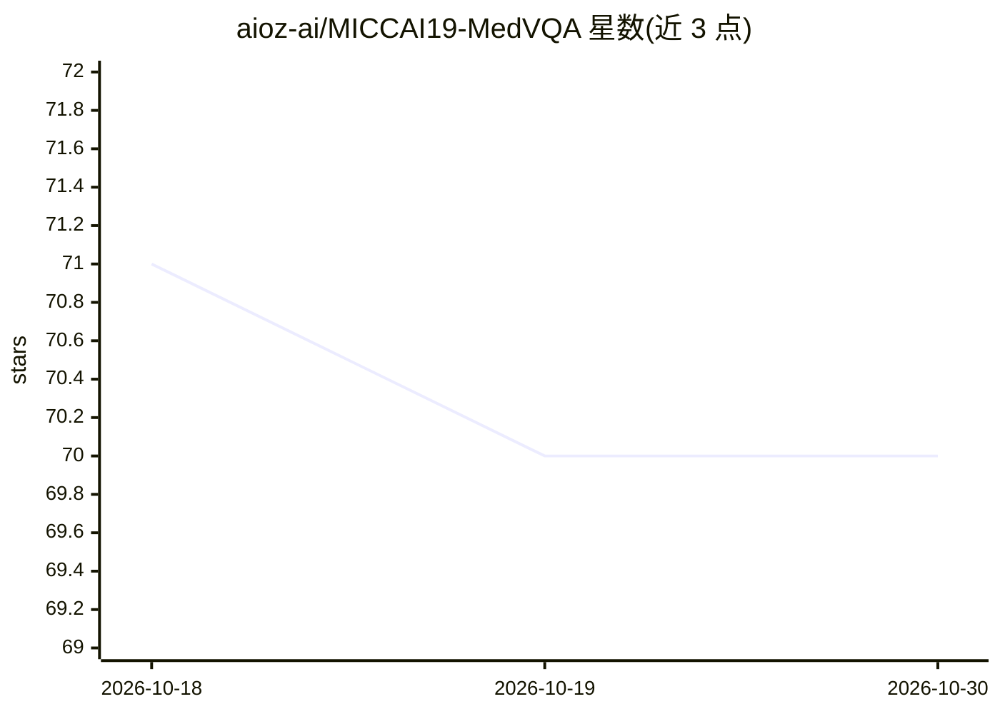

# aioz-ai/MICCAI19-MedVQA

⭐ 70 · Python · MIT · 推送 2026-04-21 · [GitHub](https://github.com/aioz-ai/MICCAI19-MedVQA) · [官网](https://blog.ai.aioz.io/research/vqa-mevf/) · 组织维护

**医学视觉问答模型 MEVF 的 MICCAI 2019 论文实现**

AIOZ AI 发布的 MICCAI 2019 论文《Overcoming Data Limitation in Medical Visual Question Answering》官方实现：提出 Mixture of Enhanced Visual Features（MEVF），结合 MAML 元学习与 CDAE 自编码器初始化特征提取模块，可搭配 SAN 或 BAN 注意力网络训练，在 VQA-RAD 数据集上达到 open-ended 43.9、close-ended 75.1。仓库提供预训练权重与 VQA-RAD 测试集测试脚本，面向复现论文的医学影像 VQA 研究者。

## 筛选速览

| 维度 | 判定 | 备注 |
|---|---|---|
| AI 角色 | `ai-native` | 本体是模型或模型工具 |
| 许可风险 | `permissive` | MIT |
| 部署形态 | `library` | 以包/库形式分发 |
| 模型依赖 | — | README 未给出锁定关系 |
| 硬件要求 | — | 无带数字的原话,不猜 |
| 安装摩擦 | `low` | 无编译、无系统依赖或容器化 |
| 成熟度 | — | 结构信号不足 |

## 能力要点

- MEVF 混合增强视觉特征，融合 MAML 与 CDAE 初始化
- 支持 SAN 与 BAN 两种注意力网络的训练与测试脚本
- 在 VQA-RAD 上 open-ended 43.9 / close-ended 75.1
- 提供 MAML/CDAE 及最优单模型的预训练权重

## 适用场景

- 复现 MICCAI 2019 医学 VQA 论文结果
- 在 VQA-RAD 数据集上训练与评测自己的 MedVQA 模型
- 基于 MEVF 特征提取模块开展后续研究

## 场景标签

`模型训练` `多模态` · 领域:感知与多模态

## 证据(README 行号)

> L5: This repository is the implementation of `MEVF` for the visual question answering task in medical domain. Our model 
> L25: $ python3 main.py --model SAN --use_RAD --RAD_dir data_RAD --maml --autoencoder --output saved_models/SAN_MEVF

## 星数曲线

2026-10-18 71 → 2026-10-30 70（-1）

---
*卡片 v1 · prompt 1.4 · 生成 2026-10-24 · 置信度 mid · 依据 README sha `e721baaf50a8` · [字段定义](../../DATASET.md)*
