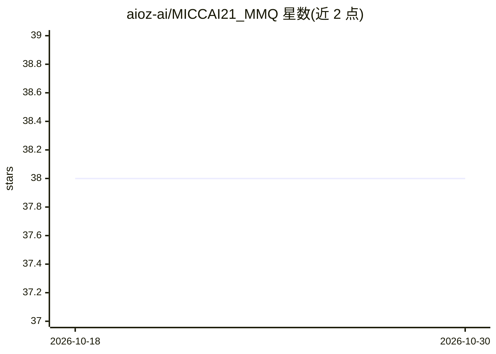

# aioz-ai/MICCAI21_MMQ

⭐ 38 · Python · MIT · 推送 2026-04-21 · [GitHub](https://github.com/aioz-ai/MICCAI21_MMQ) · [官网](https://blog.ai.aioz.io/research/vqa-mmq/) · 组织维护

**医学视觉问答模型 MMQ 的官方实现（MICCAI 2021）**

MICCAI 2021 论文 Multiple Meta-model Quantifying for Medical Visual Question Answering 的代码实现：通过 MAML 训练多个 meta-model 并量化其输出，作为图像特征用于医学 VQA。支持在 PathVQA 与 VQA-RAD 两个公开数据集上训练（shell 脚本），并提供预训练权重与测试脚本，输出结果 JSON 至 results 目录。基于 Binh D. Nguyen 的 MEVF 工作构建，提供 MMQ+MEVF 组合训练方式。运行需 Python 3.6 与 CUDA 9.2。

## 筛选速览

| 维度 | 判定 | 备注 |
|---|---|---|
| AI 角色 | `ai-native` | 本体是模型或模型工具 |
| 许可风险 | `permissive` | MIT |
| 部署形态 | `library` | 以包/库形式分发 |
| 模型依赖 | — | README 未给出锁定关系 |
| 硬件要求 | — | 无带数字的原话,不猜 |
| 安装摩擦 | `medium` | 含编译或系统依赖之一 |
| 成熟度 | — | 结构信号不足 |

## 能力要点

- MMQ：多 meta-model 训练与量化用于医学 VQA
- 支持 PathVQA 与 VQA-RAD 数据集的训练与测试
- 提供预训练权重（MMQ+MEVF、MAML、CDAE）
- MMQ+MEVF 组合训练，参数量较原 MMQ 增加约 3%

## 适用场景

- 在 PathVQA / VQA-RAD 上复现论文训练与测试
- 使用提供的预训练权重直接进行医学 VQA 测试
- 在 MMQ 基础上开展医学 VQA 方法的进一步研究

## 场景标签

`多模态` `科研工具` · 领域:学习与行业

## 证据(README 行号)

> L1: # Multiple Meta-model Quantifying for Medical Visual Question Answering (MMQ-VQA)
> L3: This repository is the implementation of `MMQ` for the visual question answering task in medical domain. Our proposa

## 星数曲线

2026-10-18 38 → 2026-10-30 38（+0）

---
*卡片 v1 · prompt 1.4 · 生成 2026-10-25 · 置信度 high · 依据 README sha `6ded77d2519a` · [字段定义](../../DATASET.md)*
