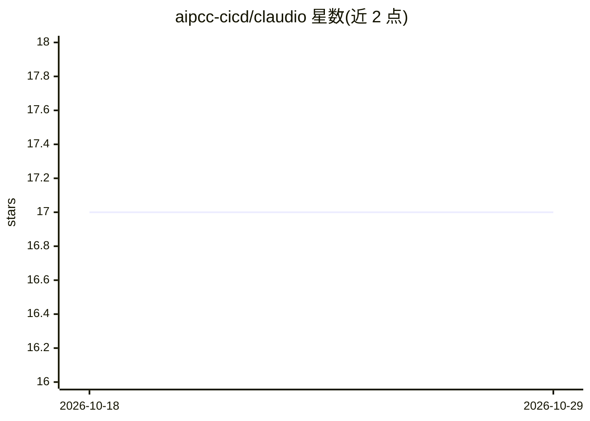

# aipcc-cicd/claudio

⭐ 17 · Shell · Apache-2.0 · 推送 2026-10-28 · [GitHub](https://github.com/aipcc-cicd/claudio) · 组织维护

**将 Claude Code 容器化的 OCI 镜像，默认经 Vertex AI 接入**

提供可移植运行 Claude Code 的 OCI 容器镜像，模型默认通过 Google Vertex AI API 接入（依赖宿主机 gcloud 凭据与 GCP 项目 ID）。构建时从 productization-skills 市场拉取技能与工具（执行 install.sh、装 Python 依赖、生成插件配置）。运行方式为包装脚本：自动处理卷挂载、用户命名空间映射与环境变量加载，挂载当前目录作为工作区。另提供 GitLab CI 模板（CLAUDIO_PROMPT 驱动、流式输出解析）与 GitHub Actions 自动发布多架构镜像到 Quay。限制：需宿主机 gcloud 登录与专用 kubeconfig 等前置配置。

## 筛选速览

| 维度 | 判定 | 备注 |
|---|---|---|
| AI 角色 | `ai-ecosystem` | LLM/agent 周边工具 |
| 许可风险 | `permissive` | Apache-2.0 |
| 部署形态 | `None` |  |
| 模型依赖 | locked-api |  |
| 硬件要求 | — | 无带数字的原话,不猜 |
| 安装摩擦 | `low` | 无编译、无系统依赖或容器化 |
| 成熟度 | — | 结构信号不足 |

## 能力要点

- OCI 镜像封装 Claude Code，默认以 Google Vertex AI 为 API 提供方
- 构建时从 productization-skills 市场安装技能、工具与 Python 依赖
- 包装脚本自动处理卷挂载、用户命名空间映射与 .env 密钥加载
- 可复用 GitLab CI 模板，支持流式输出解析与纯文本日志

## 适用场景

- 在容器中可移植地运行 Claude Code 处理本地项目文件
- 在 GitLab CI 流水线中用提示词驱动 Claude Code 执行任务
- 为 Claude Code 统一打包技能、工具与凭据配置

## 场景标签

`编码 Agent` · 领域:编码与开发

## 证据(README 行号)

> L3: OCI image to make claude code portable; the model is being setup to use through Google Vertex AI API.

## 星数曲线

2026-10-18 17 → 2026-10-29 17（+0）

---
*卡片 v1 · prompt 1.4 · 生成 2026-10-29 · 置信度 high · 依据 README sha `bc3f7b3c1d24` · [字段定义](../../DATASET.md)*
