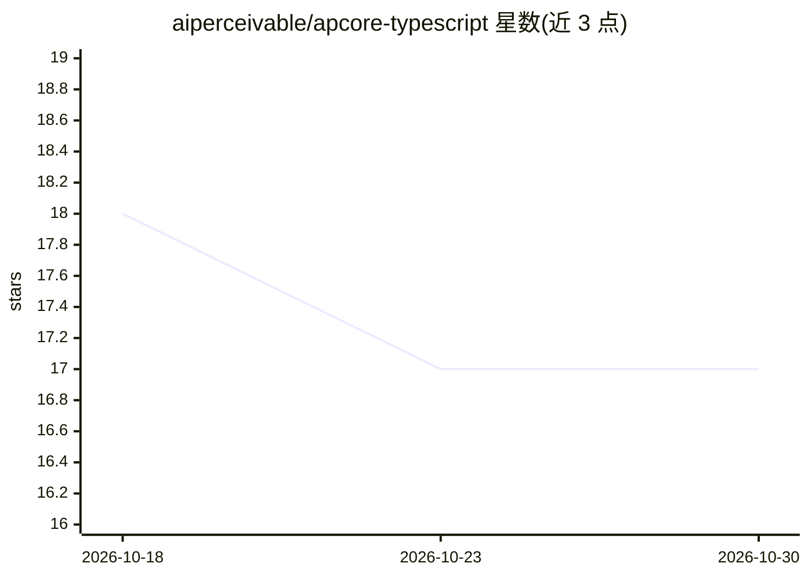

# aiperceivable/apcore-typescript

⭐ 17 · TypeScript · Apache-2.0 · 推送 2026-10-25 · [GitHub](https://github.com/aiperceivable/apcore-typescript) · [官网](https://aipartnerup.com/) · 组织维护

**TypeScript 的 AI 可感知模块开发框架：让接口可被 AI 调用并受治理**

面向 TypeScript 开发者的 schema 驱动模块开发框架（apcore），通过 TypeBox 定义的输入/输出 schema 与行为注解使接口可被 AI 感知与调用。核心是带治理的执行器管线：上下文→ACL→审批门→中间件→校验→执行，每次调用均验证、授权并留审计痕迹；另含文件式模块注册表、YAML 绑定加载、熔断中间件、追踪/指标观测、异步任务与事件系统等。v0.28.0 重点修复多项 ACL/审批安全缺陷并引入参数级人工审批。与 apcore-python/apcore-rust 保持跨语言契约一致。

## 筛选速览

| 维度 | 判定 | 备注 |
|---|---|---|
| AI 角色 | `ai-ecosystem` | LLM/agent 周边工具 |
| 许可风险 | `permissive` | Apache-2.0 |
| 部署形态 | `library` | 以包/库形式分发 |
| 模型依赖 | — | README 未给出锁定关系 |
| 硬件要求 | — | 无带数字的原话,不猜 |
| 安装摩擦 | `low` | 无编译、无系统依赖或容器化 |
| 成熟度 | — | 结构信号不足 |

## 能力要点

- 治理型执行器管线：schema 校验、ACL、审批门、中间件与审计在每次调用中执行
- 模式化 ACL 规则支持参数级审批（approval: required）与人工介入
- 内置 system.* 模块支持 AI 双向自省：健康、清单、用量与运行时控制
- 跨 SDK 一致性：与 apcore-python/apcore-rust 通过共享 conformance fixture 锁定行为

## 适用场景

- 为 AI agent 构建可被安全调用与审计的能力模块
- 需要审批门与 ACL 的破坏性操作治理场景
- 以 schema 导出让 AI 理解并调用现有接口

## 场景标签

`Agent 框架` · 领域:Agent 开发

## 证据(README 行号)

> L14: A governed runtime for agent-callable capabilities — schema, ACL, approval, and audit enforced at every call.
> L16: apcore is an AI-Perceivable module standard that makes every interface naturally perceivable and understandable by 

## 星数曲线

2026-10-18 18 → 2026-10-30 17（-1）

---
*卡片 v1 · prompt 1.4 · 生成 2026-10-29 · 置信度 high · 依据 README sha `6065638cc414` · [字段定义](../../DATASET.md)*
