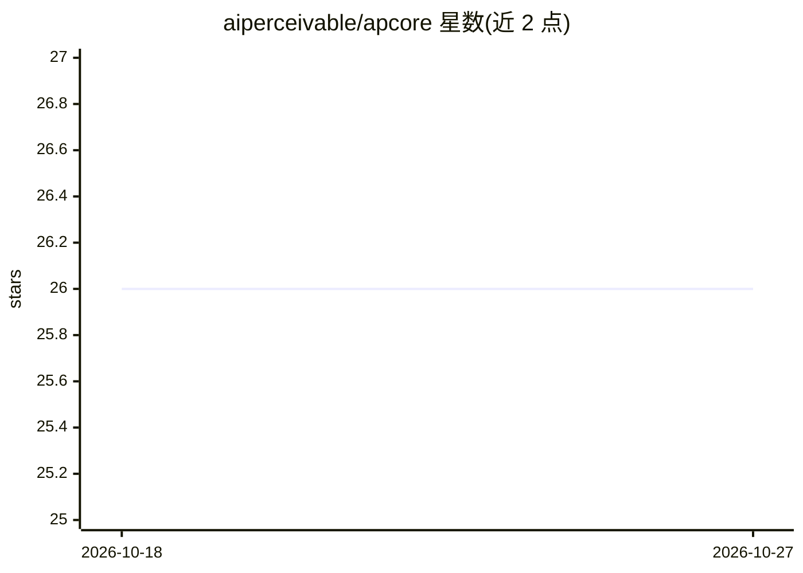

# aiperceivable/apcore

⭐ 26 · Python · Apache-2.0 · 推送 2026-10-24 · [GitHub](https://github.com/aiperceivable/apcore) · [官网](https://www.aiperceivable.com/products/apcore/) · 组织维护

**面向 AI agent 的治理化能力模块框架：一次定义、多面暴露**

一个协议中立的运行时与模块标准：开发者将应用能力定义为带描述与 JSON Schema 输入/输出的模块，运行时对每次调用统一施加身份、访问控制、人工审批、校验、中间件、结构化错误与追踪审计；通过适配器将同一能力投影为 MCP、A2A、CLI、HTTP 或直接代码调用。本仓库存放协议规范、JSON Schema 与跨语言一致性测试夹具，Python/TypeScript/Rust 运行时位于独立仓库。适用于需要在多协议、多调用方之间保持一致治理规则的开发者。

## 筛选速览

| 维度 | 判定 | 备注 |
|---|---|---|
| AI 角色 | `ai-ecosystem` | LLM/agent 周边工具 |
| 许可风险 | `permissive` | Apache-2.0 |
| 部署形态 | `library` | 以包/库形式分发 |
| 模型依赖 | — | README 未给出锁定关系 |
| 硬件要求 | — | 无带数字的原话,不猜 |
| 安装摩擦 | `low` | 无编译、无系统依赖或容器化 |
| 成熟度 | — | 结构信号不足 |

## 能力要点

- 能力模块一次定义，经适配器暴露为 MCP/A2A/CLI/HTTP/直接调用
- 每次调用执行统一十一步流水线（ACL、审批、校验、审计等）
- 模块行为注解（readonly/destructive/requires_approval 等）与默认拒绝 ACL
- 提供 Python/TypeScript/Rust 三语言 SDK 与一致性测试夹具

## 适用场景

- 为 agent 提供带访问控制与审批门的应用能力接口
- 让同一模块在 MCP、A2A、CLI、HTTP 多个表面保持一致的治理规则
- 对 agent 调用链做深度限制、循环检测与审计留痕

## 场景标签

`Agent 框架` · 领域:Agent 开发

## 证据(README 行号)

> L15: apcore is a **governed, protocol-neutral runtime and module standard** for application capabilities that agents or 
> L17: You define a capability once — a description, an input schema, an output schema and behavioral annotations. The run

## 星数曲线

2026-10-18 26 → 2026-10-27 26（+0）

---
*卡片 v1 · prompt 1.4 · 生成 2026-10-26 · 置信度 high · 依据 README sha `1e0c5c534abf` · [字段定义](../../DATASET.md)*
