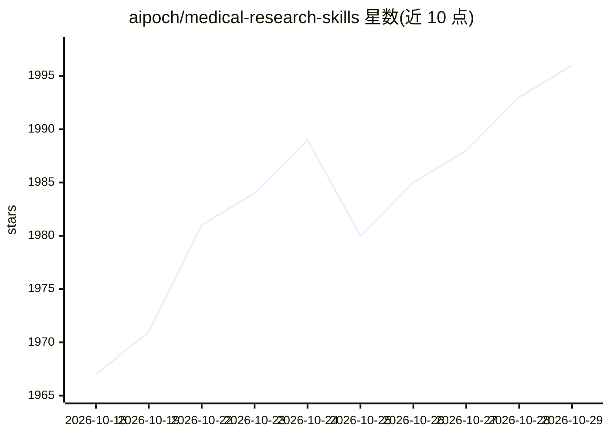

# aipoch/medical-research-skills

⭐ 1,996 · Python · MIT · 推送 2026-09-17 · [GitHub](https://github.com/aipoch/medical-research-skills) · [官网](https://aipoch.com/agent-skills) · 组织维护

**面向医学研究的 agent 技能库：550+ 条 SKILL.md 技能**

AIPOCH 维护的医学研究 agent 技能策展库，收录 550+ 条自主研发的 SKILL.md 格式技能，兼容 Claude Code、Codex 等 SKILL.md 兼容平台。按研究阶段组织为文献与证据发现、研究设计与方案开发、组学与生物信息分析、临床研究与 Meta 分析等类别，覆盖检索策略、方案生成、R/Python 生信代码、统计建模与学术写作。每条技能上线前经自研 MedSkillAudit 领域审计框架评审，部分技能收录于 AIPOCH Open-Science 工作台。

## 筛选速览

| 维度 | 判定 | 备注 |
|---|---|---|
| AI 角色 | `ai-knowledge` | 知识聚合/清单类 |
| 许可风险 | `permissive` | MIT |
| 部署形态 | `None` |  |
| 模型依赖 | — | README 未给出锁定关系 |
| 硬件要求 | — | 无带数字的原话,不猜 |
| 安装摩擦 | `low` | 无编译、无系统依赖或容器化 |
| 成熟度 | — | 结构信号不足 |

## 能力要点

- 550+ 条 SKILL.md 格式医学研究技能，兼容 Claude Code/Codex 等平台
- 按研究阶段组织：证据发现、方案设计、组学分析、临床与 Meta 分析
- 每条技能经 MedSkillAudit 领域审计框架评审
- 覆盖单细胞 RNA-seq、差异表达、免疫浸润、网络药理学等生信工作流

## 适用场景

- 为 Claude Code/Codex 类 agent 配备医学研究技能
- 文献筛选、研究方案与 Meta 分析全流程辅助
- 生成 R/Python 生物信息分析代码与图表

## 场景标签

`科研工具` `数据分析` · 领域:效率与自动化

## 证据(README 行号)

> L9: A curated library of 550+ medical research agent skills created by AIPOCH, designed to work with **Claude Code, Code
> L13: Every skill in this library is reviewed and evaluated through **MedSkillAudit** — A Domain-Specific Audit Framework

## 星数曲线

2026-10-18 1,967 → 2026-10-29 1,996（+29）

---
*卡片 v1 · prompt 1.4 · 生成 2026-10-21 · 置信度 high · 依据 README sha `668a235d08bb` · [字段定义](../../DATASET.md)*
