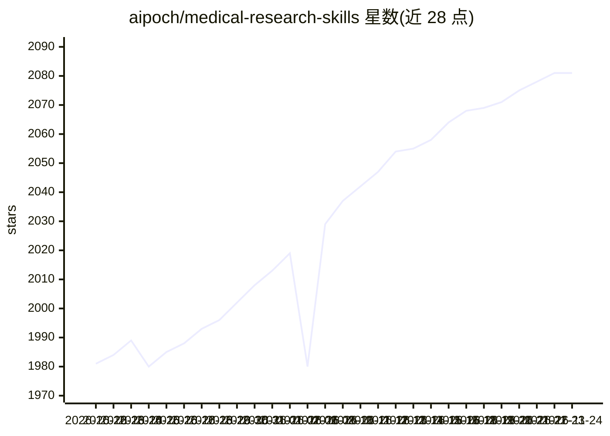

# aipoch/medical-research-skills

⭐ 2,081 · Python · MIT · 推送 2026-11-20 · [GitHub](https://github.com/aipoch/medical-research-skills) · [官网](https://aipoch.com/agent-skills) · 组织维护

**面向医学研究者、提供 550+ 医学研究 agent 技能的技能库**

由 AIPOCH 创建的医学研究 agent 技能库，含 550+ 条 SKILL.md 格式技能，兼容 Claude Code、Codex 等 agent 平台，面向医学与生物医学研究者。按证据洞察、方案设计、数据分析、学术写作等五大类组织，并按研究阶段细分（文献检索 79 项、研究设计 68 项、组学生信 52 项、临床与荟萃分析 61 项等）。技能上线前经其 MedSkillAudit 领域审计框架评审。配套的开源工作台 AIPOCH Open-Science 含该库的子集。

## 筛选速览

| 维度 | 判定 | 备注 |
|---|---|---|
| AI 角色 | `ai-knowledge` | 知识聚合/清单类 |
| 许可风险 | `permissive` | MIT |
| 部署形态 | `library` | 以包/库形式分发 |
| 模型依赖 | — | README 未给出锁定关系 |
| 硬件要求 | — | 无带数字的原话,不猜 |
| 安装摩擦 | `low` | 无编译、无系统依赖或容器化 |
| 成熟度 | — | 结构信号不足 |

## 能力要点

- 550+ 条 SKILL.md 格式技能，兼容 Claude Code / Codex 等 agent 平台
- 按证据洞察、方案设计、数据分析、学术写作等五大类组织
- 技能经 MedSkillAudit 领域审计框架评审后上线
- 覆盖文献检索、研究设计、组学生信、荟萃分析等研究阶段

## 适用场景

- 为医学研究 agent 查找文献检索与证据评估类技能
- 生成临床/转化研究方案与样本量计算
- 执行单细胞、转录组、荟萃分析等生信流程
- 撰写 SCI 论文草稿与投稿材料

## 场景标签

`科研工具` `数据分析` · 领域:效率与自动化

## 证据(README 行号)

> L9: A curated library of 550+ medical research agent skills created by AIPOCH, designed to work with **Claude Code, Code
> L27: All skills in AIPOCH are ​**originally designed and developed in-house**​, built to reflect medical research workfl

## 星数曲线

2026-10-22 1,981 → 2026-11-24 2,081（+100）

---
*卡片 v1 · prompt 1.4 · 生成 2026-11-23 · 置信度 high · 依据 README sha `824d8f63ca54` · [字段定义](../../DATASET.md)*
