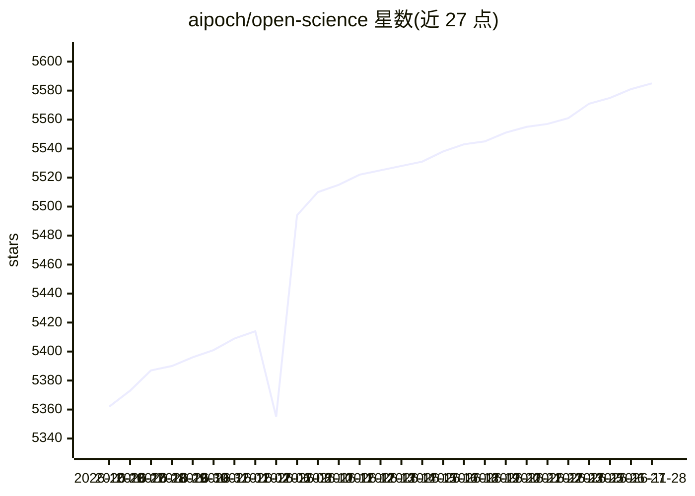

# aipoch/open-science

⭐ 5,585 · TypeScript · Apache-2.0 · 推送 2026-11-27 · [GitHub](https://github.com/aipoch/open-science) · [官网](https://aipoch.com/open-science) · 组织维护

**面向科研人员的本地优先 AI 研究工作台，支持可复现研究记录共享**

本地优先、模型后端可替换的桌面研究工作台：会话中可调用 Python/R Notebook、MCP 工具与技能市场，文件版本与执行历史记录在 Provenance 中以支持结果回溯，研究结果可导出为 .science 包或由本地语音引擎生成解说的 Research Film。安装支持三平台安装包及 winget/Homebrew/npm 等多种途径，CLI 版本自带 Node.js 运行时。AIPOCH 官方公布了 LitQA2、ScholarQA-CS2 等基准上的自测结果。

## 筛选速览

| 维度 | 判定 | 备注 |
|---|---|---|
| AI 角色 | `ai-ecosystem` | LLM/agent 周边工具 |
| 许可风险 | `permissive` | Apache-2.0 |
| 部署形态 | `desktop` | 安装包/桌面程序 |
| 模型依赖 | local-ok | 支持本地模型 |
| 硬件要求 | — | 无带数字的原话,不猜 |
| 安装摩擦 | `low` | 无编译、无系统依赖或容器化 |
| 成熟度 | — | 结构信号不足 |

## 能力要点

- .science 研究包可共享会话分支、文件版本与验证证据
- Python/R Notebook 执行与 Provenance 结果溯源
- MCP 服务器（Core/Research/Literature）供外部 agent 客户端接入
- 供应商目录含云端网关与本地运行时预设（Ollama、llama.cpp、vLLM 等）

## 适用场景

- 文献筛选与引用式回答撰写
- Notebook 中运行 Python/R 分析并追溯结果依据
- 把研究过程打包给合作者复现检查
- 通过 MCP 让自己的 agent 调用研究工具

## 场景标签

`科研工具` · 领域:学习与行业

## 证据(README 行号)

> L3:  AIPOCH Open-Science is a local-first open-source AI research workbench for reproducible science, with flexible mode
> L52: - **More ways to connect models**: Cloud gateways (Cloudflare AI Gateway, AWS Bedrock Runtime, Microsoft Foundry, V
> L219: |Choose a model|Connect a supported provider or custom gateway, or use a supported Claude or Codex subscription. A

## 星数曲线

2026-10-26 5,362 → 2026-11-28 5,585（+223）

---
*卡片 v1 · prompt 1.4 · 生成 2026-11-26 · 置信度 high · 依据 README sha `e000fc6775b9` · [字段定义](../../DATASET.md)*
