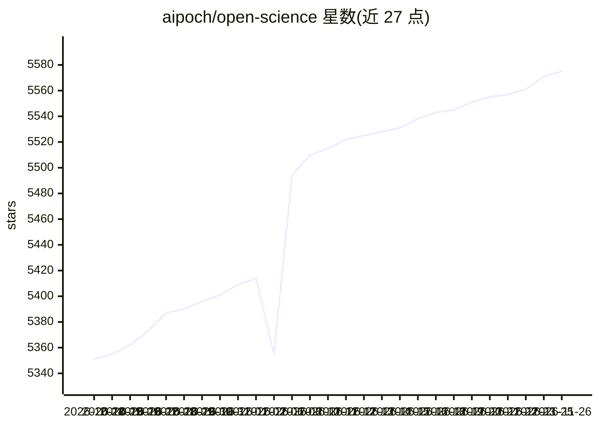

# aipoch/open-science

⭐ 5,575 · TypeScript · Apache-2.0 · 推送 2026-11-25 · [GitHub](https://github.com/aipoch/open-science) · [官网](https://aipoch.com/open-science) · 组织维护 · 中文 README

**面向科研人员的本地优先 AI 科研工作台**

本地优先的开源 AI 科研工作台，面向需要可复现研究流程的科研人员。核心机制：以 .science 研究包导出对话分支、文件版本、Notebook 记录与验证证据，接收方可追溯图表来源；内置 Python/R Notebook 执行、MCP 工具连接、技能扩展市场与 Provenance 溯源视图；数据与 API Key 存于本地，支持 macOS/Windows/Linux 桌面端与独立 CLI。

## 筛选速览

| 维度 | 判定 | 备注 |
|---|---|---|
| AI 角色 | `ai-native` | 本体是模型或模型工具 |
| 许可风险 | `permissive` | Apache-2.0 |
| 部署形态 | `desktop` | 安装包/桌面程序 |
| 模型依赖 | — | README 未给出锁定关系 |
| 硬件要求 | — | 无带数字的原话,不猜 |
| 安装摩擦 | `low` | 无编译、无系统依赖或容器化 |
| 成熟度 | — | 结构信号不足 |

## 能力要点

- .science 研究包与 Research Film 导出，结果可溯源与交接
- 内置 Python/R Notebook 执行与 Provenance 文件版本追溯
- 通过 MCP 接入外部 agent 客户端（列出 20+ 客户端配置入口）
- 多模型后端：支持 provider、自定义网关或 Claude/Codex 订阅

## 适用场景

- 导入 Zotero 文献做筛选并核查论文原文
- 在 Notebook 中运行 Python/R 分析数据并溯源结果
- 分享 .science 研究包让合作者核查证据链
- 让外部 agent 通过 MCP 提交并查看科研任务

## 场景标签

`科研工具` · 领域:学习与行业

## 证据(README 行号)

> L3:  AIPOCH Open-Science is a local-first open-source AI research workbench for reproducible science, with flexible mode
> L201: |Review literature|Import references from Zotero, screen papers against your criteria, and open the source PDFs to
> L206: |Choose a model|Connect a supported provider or custom gateway, or use a supported Claude or Codex subscription. A

## 星数曲线

2026-10-24 5,351 → 2026-11-26 5,575（+224）

---
*卡片 v1 · prompt 1.4 · 生成 2026-11-24 · 置信度 high · 依据 README sha `2fb5e4c7f88d` · [字段定义](../../DATASET.md)*
