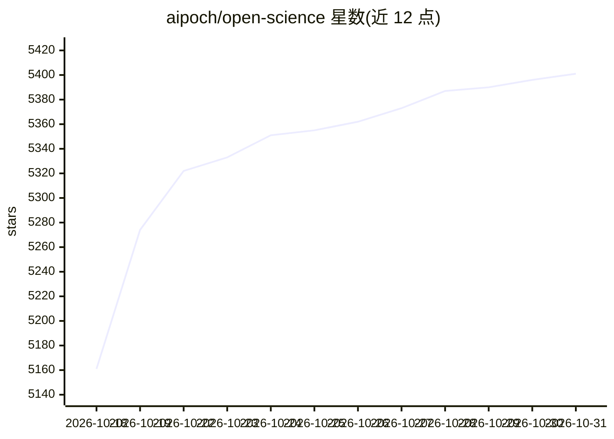

# aipoch/open-science

⭐ 5,401 · TypeScript · Apache-2.0 · 推送 2026-10-30 · [GitHub](https://github.com/aipoch/open-science) · [官网](https://aipoch.com/open-science) · 组织维护 · 中文 README

**面向科研人员的本地优先 AI 研究工作台桌面应用**

AIPOCH 开发的开源 AI 研究工作台：科研人员用自然语言描述研究目标，由科学 AI agent 读取文件、检索文献、运行 Python/R 代码、查询科学数据源并生成带溯源的报告、表格与图表。本地优先、模型无关，支持 macOS/Windows/Linux 三平台安装包与 Homebrew 安装；产物以校验和版本存储，可导出为可移植的 .science 包供审阅、移交与归档。支持从文献综述到数据分析、模拟与可视化的多学科研究流程，附 arXiv 预印本。

## 筛选速览

| 维度 | 判定 | 备注 |
|---|---|---|
| AI 角色 | `ai-native` | 本体是模型或模型工具 |
| 许可风险 | `permissive` | Apache-2.0 |
| 部署形态 | `library` | 以包/库形式分发 |
| 模型依赖 | local-ok | 支持本地模型 |
| 硬件要求 | — | 无带数字的原话,不猜 |
| 安装摩擦 | `low` | 无编译、无系统依赖或容器化 |
| 成熟度 | — | 结构信号不足 |

## 能力要点

- 科学 AI agent 结合 Python/R 执行与科学数据连接器完成研究任务
- 产物不可变版本化存储，Provenance 视图可追溯生成代码与执行历史
- 会话可导出为可移植 .science 包，跨机器导入回放（只读、不执行代码）
- 本地优先、模型无关，覆盖 macOS/Windows/Linux

## 适用场景

- 用自然语言驱动 agent 复现论文分析并产出报告与图表
- 在统一工作区管理研究项目、文献检索与代码执行
- 将研究会话打包为 .science 文件交给合作者审阅与归档

## 场景标签

`科研工具` `数据分析` · 领域:效率与自动化

## 证据(README 行号)

> L40: AIPOCH Open-Science is an AI research workbench for scientists and researchers, developed by AIPOCH with an open-so
> L42: AIPOCH Open-Science supports computational and data-intensive research across disciplines, including machine learni

## 星数曲线

2026-10-18 5,161 → 2026-10-31 5,401（+240）

---
*卡片 v1 · prompt 1.4 · 生成 2026-10-20 · 置信度 mid · 依据 README sha `621dceeb6f0b` · [字段定义](../../DATASET.md)*
