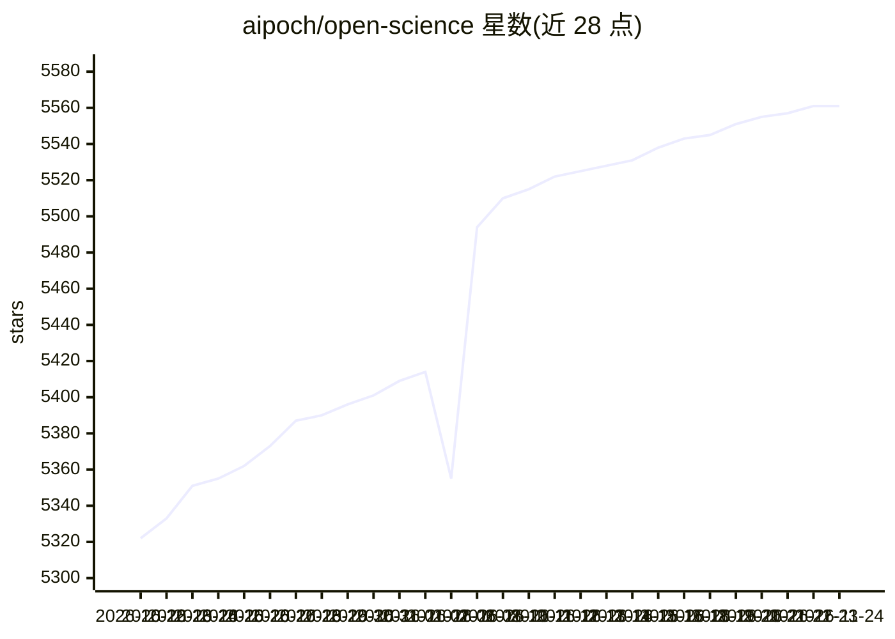

# aipoch/open-science

⭐ 5,561 · TypeScript · Apache-2.0 · 推送 2026-11-22 · [GitHub](https://github.com/aipoch/open-science) · [官网](https://aipoch.com/open-science) · 组织维护

**本地优先的科研 AI 工作台：带溯源与可复现研究记录**

面向科研工作流的桌面 AI 工作台，覆盖 macOS/Windows/Linux，含 CLI 与 Web UI。用户描述研究目标后由内置 Agent 执行任务，支持 Python/R Notebook 执行、技能/连接器扩展、MCP 工具接入，以及把文件版本与执行历史记录在 Provenance 中供追溯。结果可导出为 .science 研究包供他人核查证据，或生成带英文旁白的 Research Film。安装途径包括安装包、winget/Homebrew/npm；模型后端可配置不同 provider 或订阅。README 附带其自评基准结果，注明为本地运行、未为本次发布重跑。

## 筛选速览

| 维度 | 判定 | 备注 |
|---|---|---|
| AI 角色 | `ai-native` | 本体是模型或模型工具 |
| 许可风险 | `permissive` | Apache-2.0 |
| 部署形态 | `desktop` | 安装包/桌面程序 |
| 模型依赖 | locked-api |  |
| 硬件要求 | — | 无带数字的原话,不猜 |
| 安装摩擦 | `low` | 无编译、无系统依赖或容器化 |
| 成熟度 | — | 结构信号不足 |

## 能力要点

- .science 研究包：导出对话分支、文件版本与验证证据，接收方可只读核查并 Fork 续作
- Research Film：从会话记录生成演示影片，本地语音引擎生成英文旁白，可导出 HTML 播放器或 MP4
- Provenance 溯源：查看结果的输入、代码与执行历史，可在配方与运行时齐备时重跑
- Python/R Notebook 执行与技能/连接器市场扩展

## 适用场景

- 从 Zotero 导入文献并按标准筛选论文
- 在 Notebook 中运行 Python/R 分析数据并对照源文件查看结果
- 与同事共享 .science 包以便核查结论背后的步骤
- 通过 MCP 让自己的 agent 提交研究任务并查看结果

## 场景标签

`科研工具` `数据分析` · 领域:效率与自动化

## 证据(README 行号)

> L3:  AIPOCH Open-Science is a local-first open-source AI research workbench for reproducible science, with flexible mode
> L135: 1. Click **New project**, open a session, and describe your research goal, inputs, and expected outputs.
> L141: ### Connect your own agent through MCP

## 星数曲线

2026-10-22 5,322 → 2026-11-24 5,561（+239）

---
*卡片 v1 · prompt 1.4 · 生成 2026-11-23 · 置信度 high · 依据 README sha `0cc8be82e1ac` · [字段定义](../../DATASET.md)*
