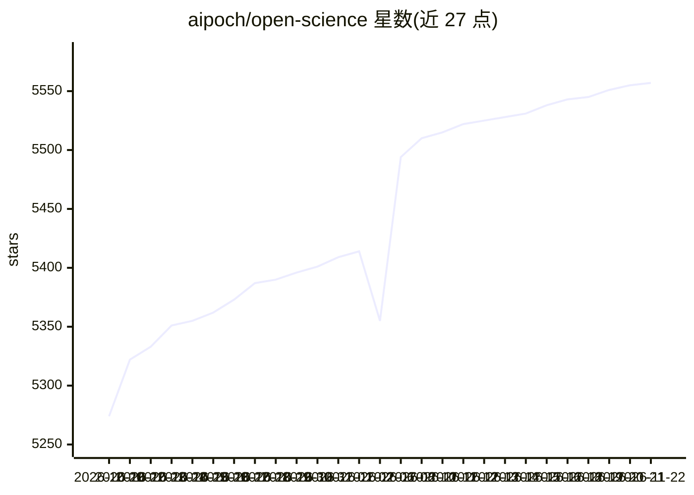

# aipoch/open-science

⭐ 5,557 · TypeScript · Apache-2.0 · 推送 2026-11-21 · [GitHub](https://github.com/aipoch/open-science) · [官网](https://aipoch.com/open-science) · 组织维护 · 中文 README

**科研人员可复现研究的本地优先 AI 工作台桌面应用**

本地优先的开源 AI 科研工作台，覆盖 macOS/Windows/Linux 桌面端与独立 CLI。用户创建研究项目、附加文件、选择模型与审批模式后由 agent 执行任务，支持 Zotero 文献导入、Python/R Notebook 执行、结果溯源（Provenance 查看输入、代码与执行历史）、.science 研究包分享与 Research Film 导出。通过 MCP 可让外部 agent 客户端接入本产品；模型后端可配置多种 provider 或自定义网关。

## 筛选速览

| 维度 | 判定 | 备注 |
|---|---|---|
| AI 角色 | `ai-native` | 本体是模型或模型工具 |
| 许可风险 | `permissive` | Apache-2.0 |
| 部署形态 | `desktop` | 安装包/桌面程序 |
| 模型依赖 | — | README 未给出锁定关系 |
| 硬件要求 | — | 无带数字的原话,不猜 |
| 安装摩擦 | `low` | 无编译、无系统依赖或容器化 |
| 成熟度 | — | 结构信号不足 |

## 能力要点

- .science 研究包分享对话分支、文件版本与验证证据，接收方可 Fork 续作
- Provenance 溯源：检查结果的输入、代码与执行历史并可复跑
- Python/R Notebook 执行与 Zotero 文献筛选
- MCP stdio 服务器接入约 25 种外部 agent 客户端

## 适用场景

- 导入 Zotero 文献并按标准筛选论文、核查 PDF 中的发现
- 在 Notebook 中运行 Python/R 分析数据并审阅图表
- 把研究结果打包成 .science 包供他人核验证据
- 让 Claude Code/Codex CLI 等 agent 通过 MCP 提交科研任务

## 场景标签

`科研工具` · 领域:学习与行业

## 证据(README 行号)

> L3:  AIPOCH Open-Science is a local-first open-source AI research workbench for reproducible science, with flexible mode
> L141: ### Connect your own agent through MCP
> L200: |Task|How it works|

## 星数曲线

2026-10-20 5,274 → 2026-11-22 5,557（+283）

---
*卡片 v1 · prompt 1.4 · 生成 2026-11-22 · 置信度 high · 依据 README sha `7069097fc252` · [字段定义](../../DATASET.md)*
