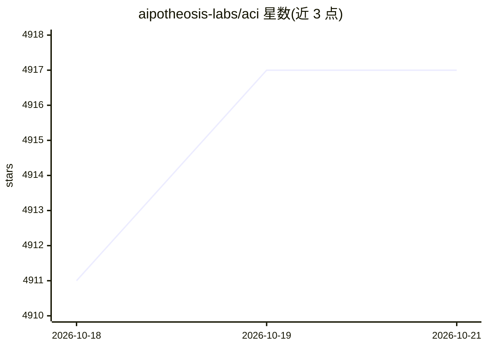

# aipotheosis-labs/aci

⭐ 4,917 · Python · Apache-2.0 · 推送 2026-05-28 · [GitHub](https://github.com/aipotheosis-labs/aci) · [官网](https://www.aci.dev/) · 组织维护

**开源工具调用平台：为 AI agent 接入 600+ 工具与统一 MCP 服务器**

面向 AI agent 开发者的开源工具调用基础设施：将 600+ 预建集成（Google Calendar、Slack、Vercel 等）以直接函数调用或统一 MCP 服务器两种方式提供给任意 agentic IDE 或自建 agent。内置多租户 OAuth 认证与密钥管理、自然语言权限边界、动态工具发现和工具调用日志，框架与模型无关。全部组件以 Apache 2.0 开源，另有 aci.dev 托管服务；本地运行需分别参照 backend 与 frontend 的 README 部署，提供 Python/TypeScript SDK。

## 筛选速览

| 维度 | 判定 | 备注 |
|---|---|---|
| AI 角色 | `ai-ecosystem` | LLM/agent 周边工具 |
| 许可风险 | `permissive` | Apache-2.0 |
| 部署形态 | `library` | 以包/库形式分发 |
| 模型依赖 | — | README 未给出锁定关系 |
| 硬件要求 | — | 无带数字的原话,不猜 |
| 安装摩擦 | `low` | 无编译、无系统依赖或容器化 |
| 成熟度 | — | 结构信号不足 |

## 能力要点

- 600+ 预建集成，经统一 MCP 服务器或 SDK 直接函数调用
- 多租户 OAuth 流程与密钥管理
- 自然语言权限边界、动态工具发现与工具调用日志
- 框架与模型无关，Apache 2.0 全量开源

## 适用场景

- 让 agentic IDE 通过单个 MCP 服务器操作 Vercel/Supabase/Cloudflare 等平台实现 VibeOps
- 构建可搜索网页、管理日历、发邮件的个人助理聊天机器人
- 为多用户 agent 应用统一管理各 SaaS 服务的认证与权限

## 场景标签

`Agent 框架` · 领域:Agent 开发

## 证据(README 行号)

> L18: ACI.dev is the open-source tool-calling platform that hooks up 600+ tools into any agentic IDE or custom AI agent. 
> L45: - **Flexible Access Methods**: Use our unified MCP server or our lightweight SDK for direct function calling.

## 星数曲线

2026-10-18 4,911 → 2026-10-21 4,917（+6）

---
*卡片 v1 · prompt 1.4 · 生成 2026-10-20 · 置信度 mid · 依据 README sha `759be9529b1e` · [字段定义](../../DATASET.md)*
