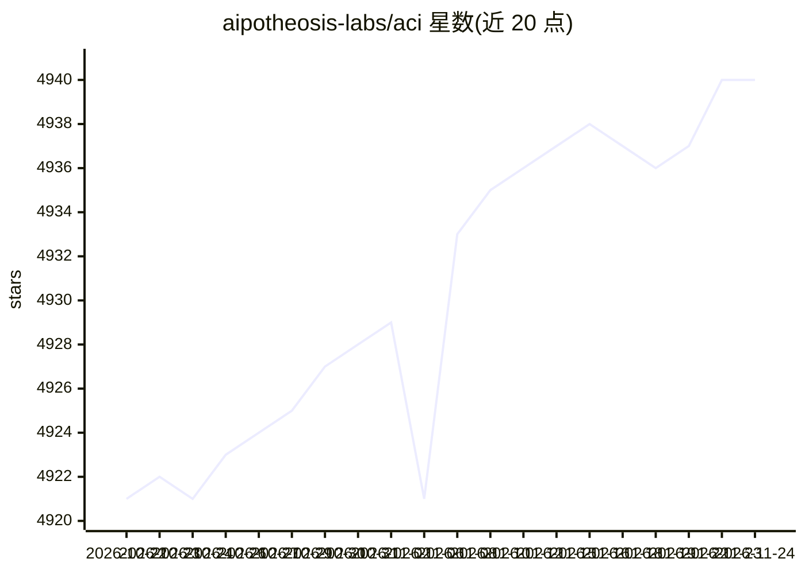

# aipotheosis-labs/aci

⭐ 4,941 · Python · Apache-2.0 · 推送 2026-11-01 · [GitHub](https://github.com/aipotheosis-labs/aci) · [官网](https://www.aci.dev/) · 组织维护

**给 AI Agent 接入 600+ 工具的开源工具调用平台**

ACI.dev 是一个开源工具调用平台，为 agentic IDE 或自定义 AI Agent 提供对 600+ 集成服务的访问，通过直接函数调用或统一 MCP 服务器两种方式暴露。平台内置 OAuth 流程与密钥管理、多租户认证、自然语言权限边界与动态工具发现，并提供工具调用日志。后端、开发者门户与集成本身以 Apache 2.0 发布，可在本地运行完整平台（后端服务器与前端门户），另有托管服务版本。

## 筛选速览

| 维度 | 判定 | 备注 |
|---|---|---|
| AI 角色 | `ai-ecosystem` | LLM/agent 周边工具 |
| 许可风险 | `permissive` | Apache-2.0 |
| 部署形态 | `library` | 以包/库形式分发 |
| 模型依赖 | — | README 未给出锁定关系 |
| 硬件要求 | — | 无带数字的原话,不猜 |
| 安装摩擦 | `low` | 无编译、无系统依赖或容器化 |
| 成熟度 | — | 结构信号不足 |

## 能力要点

- 600+ 预构建集成，统一 MCP 服务器或轻量 SDK 两种接入方式
- 多租户 OAuth 认证与密钥管理
- 自然语言权限边界与动态工具发现，降低 LLM 上下文负担
- Apache 2.0 全开源，框架与模型无关

## 适用场景

- 让 agentic IDE 通过一个统一 MCP 服务器操作 Vercel、Supabase、Cloudflare 等平台完成部署
- 构建能搜索网页、管理日历、发邮件的助手聊天机器人
- 为销售或客服 Agent 统一管理多用户对多个 SaaS 服务的认证与权限

## 场景标签

`Agent 框架` · 领域:Agent 开发

## 证据(README 行号)

> L18: ACI.dev is the open-source tool-calling platform that hooks up 600+ tools into any agentic IDE or custom AI agent. 
> L48: - **Framework & Model Agnostic**: Works with any LLM framework and agent architecture.

## 星数曲线

2026-10-22 4,921 → 2026-11-24 4,940（+19）

---
*卡片 v1 · prompt 1.4 · 生成 2026-11-22 · 置信度 mid · 依据 README sha `b335f69bd06a` · [字段定义](../../DATASET.md)*
