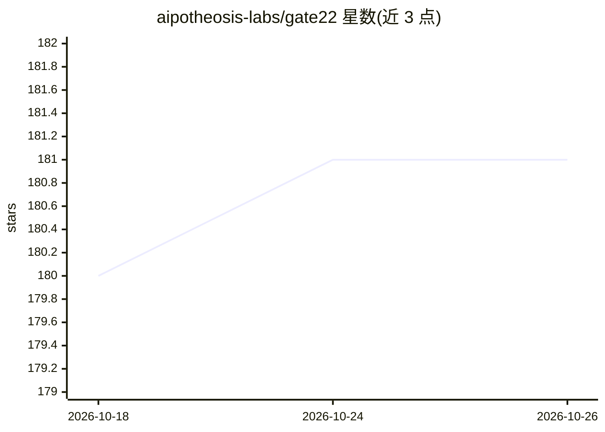

# aipotheosis-labs/gate22

⭐ 181 · TypeScript · Apache-2.0 · 推送 2025-12-12 · [GitHub](https://github.com/aipotheosis-labs/gate22) · [官网](https://gateway.aci.dev) · 组织维护

**面向团队的开源 MCP 网关与控制平面，治理 agent 工具权限与审计**

由 ACI.dev 团队维护的 MCP 网关与控制平面：管理员接入任意远程 MCP 服务器（内部或外部），设定凭证模式（组织共享或按用户）与函数级允许列表；开发者从被授权的 MCP 配置组合 bundle，通过单一统一 MCP 端点（仅 search 与 execute 两个函数）暴露，运行时动态发现工具以节省上下文窗口。面向平台/基础设施、安全 GRC、数据分析工程团队，README 明确说明尚不适合单用户个人场景。本地运行需分别按 backend 与 frontend 各自 README 操作。

## 筛选速览

| 维度 | 判定 | 备注 |
|---|---|---|
| AI 角色 | `ai-ecosystem` | LLM/agent 周边工具 |
| 许可风险 | `permissive` | Apache-2.0 |
| 部署形态 | `None` |  |
| 模型依赖 | — | README 未给出锁定关系 |
| 硬件要求 | — | 无带数字的原话,不猜 |
| 安装摩擦 | `low` | 无编译、无系统依赖或容器化 |
| 成熟度 | `idea` | |

## 能力要点

- 函数级允许列表权限控制（按 MCP 配置）
- 管理员设定凭证模式：组织共享或按用户
- bundle 压缩多个 MCP/工具为单一端点、仅 search/execute 两个函数
- MCP 工具列表刷新与 diff 视图

## 适用场景

- 组织级推行 agentic IDE 时统一治理 agent 可用的工具与权限
- 安全/GRC 团队实现最小权限执行与工具调用审计
- 数据团队以受控方式开放内部工具/BI 给 AI agent 访问

## 场景标签

`模型网关` `LLM 可观测性` · 领域:Agent 开发

## 证据(README 行号)

> L13: Govern which tools agents can use, what they can do, and how it’s audited—across agentic IDEs like Cursor, or other
> L15: **Gate22 is built for engineering organizations and teams** (Platform/Infra/DevEx, Security, Data/Analytics Eng). A

## 星数曲线

2026-10-18 180 → 2026-10-26 181（+1）

---
*卡片 v1 · prompt 1.4 · 生成 2026-10-22 · 置信度 high · 依据 README sha `5665ffbabaa6` · [字段定义](../../DATASET.md)*
