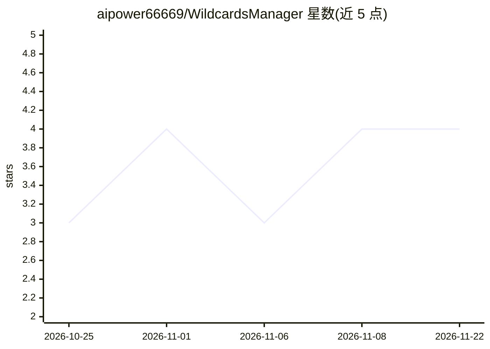

# aipower66669/WildcardsManager

⭐ 4 · TypeScript · NOASSERTION · 推送 2026-10-31 · [GitHub](https://github.com/aipower66669/WildcardsManager) · 个人维护

**为 SD/ComfyUI 通配符库提供图编辑与校验的桌面工具**

面向 Stable Diffusion / ComfyUI Dynamic Prompts 通配符库的桌面应用：打开文件夹后以依赖图展示通配符引用关系，检测缺失文件、循环与语法错误，支持就地编辑、带撤销的安全重构与 Monte Carlo 模拟（至 1,000,000 次）。集成 Civitai 与 Hugging Face 浏览下载、LoRA/检查点目录管理，并可通过 ComfyUI workflow 以 Krea 2 或 SDXL/Pony/Illustrious 检查点出图。非商用许可，Windows 提供 NSIS 安装包，源码需 Node.js 22.12+ 运行。

## 筛选速览

| 维度 | 判定 | 备注 |
|---|---|---|
| AI 角色 | `ai-enhanced` | 去掉 AI 部分产品仍成立 |
| 许可风险 | `none` | NOASSERTION |
| 部署形态 | `desktop` | 安装包/桌面程序 |
| 模型依赖 | — | README 未给出锁定关系 |
| 硬件要求 | — | 无带数字的原话,不猜 |
| 安装摩擦 | `low` | 无编译、无系统依赖或容器化 |
| 成熟度 | — | 结构信号不足 |

## 能力要点

- 依赖图浏览与校验：缺失引用、glob 不匹配、循环、语法错误定位
- 带 50 条撤销/重做与时间戳备份的安全重构
- 种子化加权随机展开与 Monte Carlo 模拟分析可达性
- 内置 Civitai/Hugging Face 浏览器与持久下载队列

## 适用场景

- 梳理和清理体积庞大、层层嵌套的通配符库
- 重构通配符引用前预览影响、避免改坏依赖
- 从提示词文件夹直接驱动 ComfyUI 批量出图
- 在应用内检索并下载 Civitai 的 LoRA 与检查点

## 场景标签

`提示工程` `图像生成` · 领域:Agent 开发

## 证据(README 行号)

> L11: A desktop graph editor, validator, simulator, and safe refactoring tool for Stable Diffusion / ComfyUI **Dynamic Pr
> L49: turning into a ComfyUI or A1111 plugin.
> L57: |**Generate with ComfyUI**|**Generation** tab: typed prompt or prompt-folder `!gen.txt`, three style profiles, a fi

## 星数曲线

2026-10-25 3 → 2026-11-22 4（+1）

---
*卡片 v1 · prompt 1.4 · 生成 2026-11-21 · 置信度 high · 依据 README sha `206f2895312f` · [字段定义](../../DATASET.md)*
