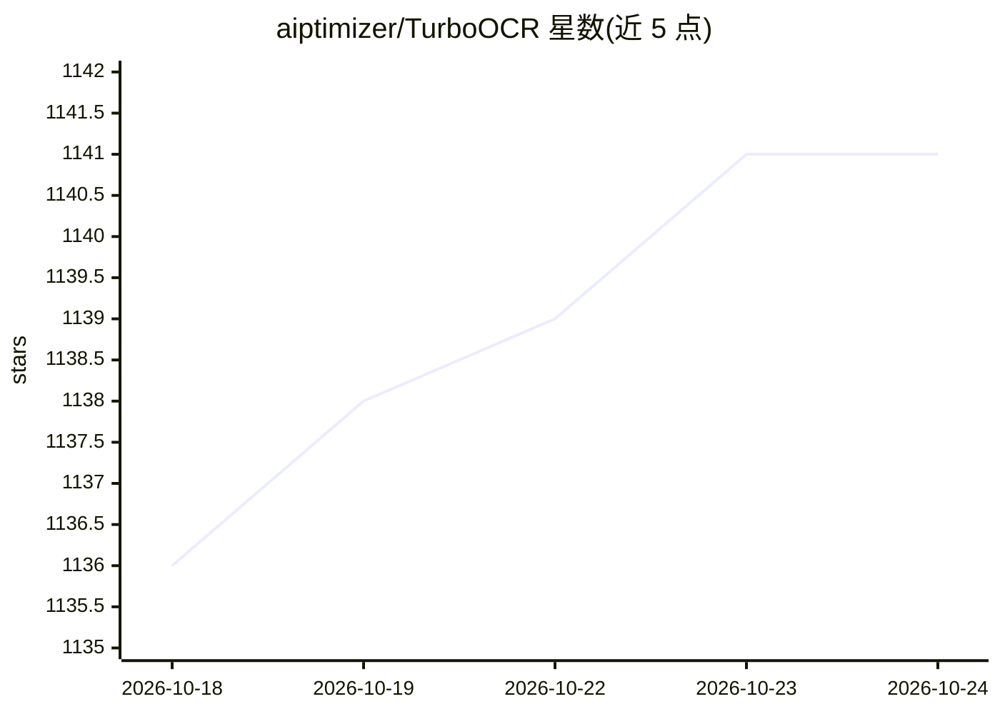

# aiptimizer/TurboOCR

⭐ 1,141 · C++ · MIT · 推送 2026-09-27 · [GitHub](https://github.com/aiptimizer/TurboOCR) · [官网](https://turboocr.com) · 组织维护 · 中文 README

**GPU 文档解析推理服务：OCR/版面/表格/公式转 Markdown**

基于 C++/CUDA/TensorRT 的本地 GPU 文档解析服务，流水线采用 PP-OCRv6 检测与识别（tiny/small/medium 三档），叠加 PP-DocLayoutV3 版面分析、SLANet-Plus 表格转 HTML、PP-FormulaNet-S 公式转 LaTeX，按请求严格可选开启；输出含阅读顺序的 Markdown。单二进制同时提供 HTTP（经 nginx）与 gRPC 接口，权重内置 Docker 镜像，首次启动自动构建 TensorRT 引擎。限制：目前仅发布 Linux + NVIDIA 后端，要求 Turing 及以上 GPU，纯文本约 4 GB 显存、全流水线约 8 GB；Apple Metal/Intel OpenVINO 在测试中，AMD ROCm 开发中。

## 筛选速览

| 维度 | 判定 | 备注 |
|---|---|---|
| AI 角色 | `ai-native` | 本体是模型或模型工具 |
| 许可风险 | `permissive` | MIT |
| 部署形态 | `self-host` | docker 或自建部署 |
| 模型依赖 | — | README 未给出锁定关系 |
| 硬件要求 | `gpu-8g` | |
| 安装摩擦 | `low` | 无编译、无系统依赖或容器化 |
| 成熟度 | `idea` | |

## 能力要点

- PP-OCRv6 检测+识别三档模型，覆盖拉丁/中文/日文，另保留 PP-OCRv5 识别器支持阿拉伯等 5 种文字
- 表格→HTML、公式→LaTeX、版面+阅读顺序，按请求参数严格可选
- 单二进制同服 HTTP 与 gRPC，含 Prometheus 指标与健康探针
- Docker 一行部署，权重内置镜像，TensorRT 引擎首次启动自动构建并缓存

## 适用场景

- 搭建高吞吐的本地 OCR/文档解析 API 服务
- 把 PDF 或扫描件批量转成带表格和公式的 Markdown
- 在表单/票据场景做低延迟 GPU 文字识别

## 场景标签

`文档解析` `OCR` · 领域:知识与检索

## 证据(README 行号)

> L35: An extremely fast GPU **document parser** — not just OCR. PP-OCRv6 detection +
> L38: locally (no VLM), behind HTTP and gRPC. Whole-page OCR runs at **up to 559 images/s

## 星数曲线

2026-10-18 1,136 → 2026-10-24 1,141（+5）

---
*卡片 v1 · prompt 1.4 · 生成 2026-10-21 · 置信度 high · 依据 README sha `66a0fd6c76cd` · [字段定义](../../DATASET.md)*
