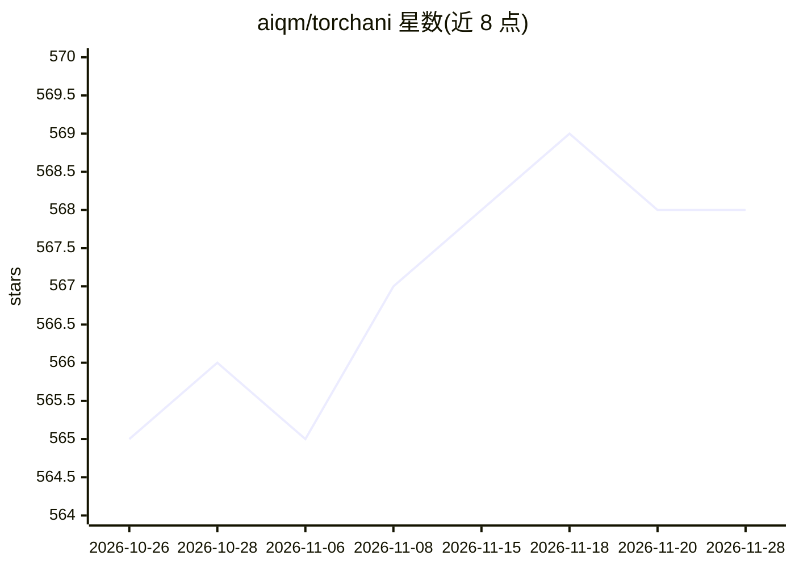

# aiqm/torchani

⭐ 568 · Python · MIT · 推送 2026-11-27 · [GitHub](https://github.com/aiqm/torchani) · [官网](https://aiqm.github.io/torchani/) · 组织维护

**训练与研究 ANI 型神经网络原子间势的开源库**

TorchANI 2 是支持训练、开发与研究 ANI 型神经网络原子间势（NN-IP）的 Python 库，由 Roitberg 课题组维护。提供 C++ 与 CUDA 扩展加速描述符计算与网络推理，提供可执行 CLI 脚本 ani，并与 Amber（sander/pmemd）有 ML/MM 分子动力学接口。安装推荐 pip/uv，需 PyTorch >= 2.0；macOS 无 CUDA 支持，MPS 与 AMD ROCm/HIP 未测试。

## 筛选速览

| 维度 | 判定 | 备注 |
|---|---|---|
| AI 角色 | `ai-native` | 本体是模型或模型工具 |
| 许可风险 | `permissive` | MIT |
| 部署形态 | `library` | 以包/库形式分发 |
| 模型依赖 | — | README 未给出锁定关系 |
| 硬件要求 | — | 无带数字的原话,不猜 |
| 安装摩擦 | `medium` | 含编译或系统依赖之一 |
| 成熟度 | — | 结构信号不足 |

## 能力要点

- 支持 ANI 型神经网络势的训练、开发与研究
- 提供 C++ 与 CUDA 扩展加速描述符计算与网络推理
- 与 Amber（sander/pmemd）的 ML/MM 分子动力学接口
- 提供 ani 命令行工具与构建扩展子命令

## 适用场景

- 训练和使用 ANI 风格的神经网络原子间势
- 通过 TorchANI-Amber 接口运行 ML 或 ML/MM 分子动力学
- 在 CUDA GPU 上加速描述符与网络推理计算

## 场景标签

`模型训练` `科研工具` `推理引擎` · 领域:学习与行业

## 证据(README 行号)

> L9: TorchANI 2 is an open-source library that supports training, development, and research
> L23: a GitHub issue. TorchANI 2 is currently tested against PyTorch 2.13 and CUDA 13.0
> L61: TorchANI 2 provides C++ and CUDA extensions for accelerated computation of descriptors

## 星数曲线

2026-10-26 565 → 2026-11-28 568（+3）

---
*卡片 v1 · prompt 1.4 · 生成 2026-11-26 · 置信度 high · 依据 README sha `c6b0c12b2ba0` · [字段定义](../../DATASET.md)*
