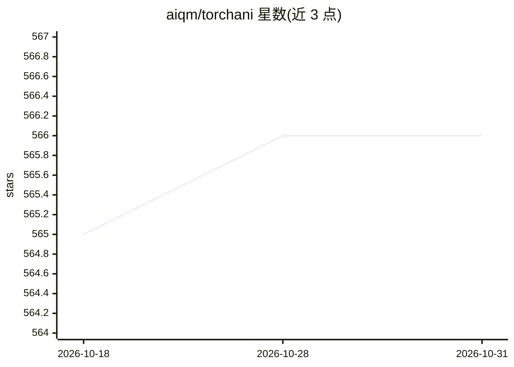

# aiqm/torchani

⭐ 566 · Python · MIT · 推送 2026-10-26 · [GitHub](https://github.com/aiqm/torchani) · [官网](https://aiqm.github.io/torchani/) · 组织维护

**面向计算化学研究者的 ANI 神经网络势训练与开发库**

TorchANI 2.0 是基于 PyTorch 的开源库，支持 ANI 类神经网络原子间势（NN-IP）的训练、开发与研究，由 Roitberg 组开发维护。提供 C++/CUDA 扩展加速描述符计算与网络推理，通过 ani 命令行构建扩展并附带工具；可与 Amber（sander/pmemd）对接运行 ML 或 ML/MM 分子动力学。安装以 pip 为主（conda 包不再维护），要求 PyTorch>=2.0，推荐 CUDA GPU 运行，macOS 无 CUDA 支持且未经 MPS 测试，AMD GPU（ROCm/HIP）未经测试。

## 筛选速览

| 维度 | 判定 | 备注 |
|---|---|---|
| AI 角色 | `ai-native` | 本体是模型或模型工具 |
| 许可风险 | `permissive` | MIT |
| 部署形态 | `library` | 以包/库形式分发 |
| 模型依赖 | — | README 未给出锁定关系 |
| 硬件要求 | — | 无带数字的原话,不猜 |
| 安装摩擦 | `medium` | 含编译或系统依赖之一 |
| 成熟度 | — | 结构信号不足 |

## 能力要点

- ANI 神经网络势的训练、开发与研究支持
- C++/CUDA 扩展加速描述符计算与推理（可指定 SM 架构构建）
- TorchANI-Amber 接口支持 ML 与 ML/MM 分子动力学
- 提供 ani 命令行工具与可本地构建的 conda 配方

## 适用场景

- 训练或微调 ANI 类神经网络势用于分子体系
- 在 Amber 中以 ML 或 ML/MM 方式运行分子动力学
- 量子化学/分子模拟研究中的势能面计算

## 场景标签

 · 领域:计算化学/分子模拟

## 证据(README 行号)

> L9: TorchANI 2.0 is an open-source library that supports training, development, and research
> L63: TorchANI 2.0 provides C++ and CUDA extensions for accelerated computation of descriptors

## 星数曲线

2026-10-18 565 → 2026-10-31 566（+1）

---
*卡片 v1 · prompt 1.4 · 生成 2026-10-21 · 置信度 high · 依据 README sha `0f42b77f8fca` · [字段定义](../../DATASET.md)*
