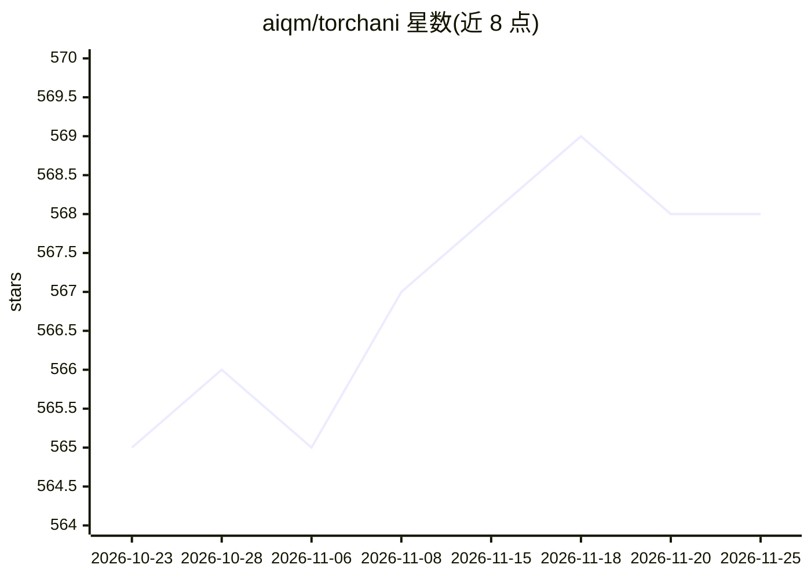

# aiqm/torchani

⭐ 568 · Python · MIT · 推送 2026-11-20 · [GitHub](https://github.com/aiqm/torchani) · [官网](https://aiqm.github.io/torchani/) · 组织维护

**训练与研究 ANI 神经网络原子间势的开源 PyTorch 库**

TorchANI 2 是一个支持 ANI 类神经网络原子间势（NN-IP）训练、开发与研究的开源库，由 Roitberg 课题组开发维护。提供 C++ 与 CUDA 扩展加速描述符计算与网络推理，附带可执行脚本 ani 的命令行工具，并可与 Amber（sander/pmemd）接口进行分子动力学模拟。安装推荐 pip/uv，CUDA 扩展需用 ani build-extensions 单独构建，macOS 无 CUDA 支持且 MPS 未测试。

## 筛选速览

| 维度 | 判定 | 备注 |
|---|---|---|
| AI 角色 | `ai-native` | 本体是模型或模型工具 |
| 许可风险 | `permissive` | MIT |
| 部署形态 | `library` | 以包/库形式分发 |
| 模型依赖 | — | README 未给出锁定关系 |
| 硬件要求 | — | 无带数字的原话,不猜 |
| 安装摩擦 | `medium` | 含编译或系统依赖之一 |
| 成熟度 | — | 结构信号不足 |

## 能力要点

- 支持 ANI 神经网络原子间势的训练、开发与研究
- 提供 C++ 与 CUDA 扩展加速描述符计算与网络推理
- 提供 TorchANI-Amber 接口支持 ML 与 ML/MM 分子动力学
- 提供 ani 命令行工具及迁移指南（legacy_state_dict 兼容旧模型）

## 适用场景

- 训练和开发自己的神经网络原子间势模型
- 结合 Amber 运行基于机器学习势的分子动力学模拟
- 量子化学/分子模拟研究中的能量与力预测

## 场景标签

`模型训练` · 领域:训练与推理

## 证据(README 行号)

> L9: TorchANI 2 is an open-source library that supports training, development, and research
> L61: TorchANI 2 provides C++ and CUDA extensions for accelerated computation of descriptors
> L128: TorchANI 2 can be run in CUDA-enabled GPUs. This is **highly recommended** unless

## 星数曲线

2026-10-23 565 → 2026-11-25 568（+3）

---
*卡片 v1 · prompt 1.4 · 生成 2026-11-25 · 置信度 high · 依据 README sha `00162ca40b02` · [字段定义](../../DATASET.md)*
