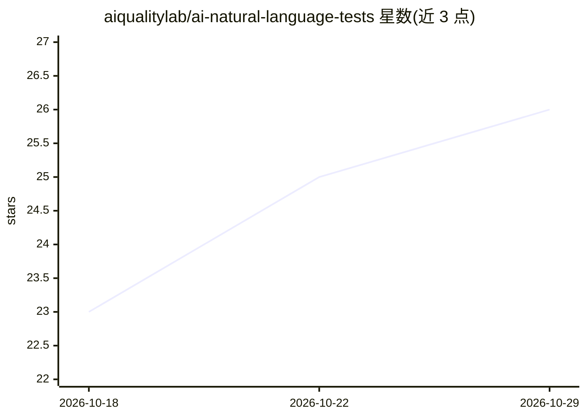

# aiqualitylab/ai-natural-language-tests

⭐ 26 · Python · AGPL-3.0 · 推送 2026-10-28 · [GitHub](https://github.com/aiqualitylab/ai-natural-language-tests) · [官网](http://tests.aiqualitylab.org/) · 组织维护

**从自然语言需求生成并执行 E2E 测试的平台，面向测试/工程团队**

以 Python CLI 为主的测试生成平台：输入自然语言需求，经 LangGraph 五步工作流（URL/HTML 分析、历史模式检索、生成、可选执行）产出 Cypress、Playwright、WebdriverIO 及实验性 Appium 的可执行测试代码。支持多轮对话式测试修订、AI 代码评审、FAISS+SQLite 模式记忆与 OpenTelemetry/Loki 可观测性。LLM 后端支持 OpenAI/Anthropic/Google 云端及 Ollama、vLLM、LM Studio 本地端点。Appium 为实验性，执行依赖外部移动基础设施；需至少一个 provider key。

## 筛选速览

| 维度 | 判定 | 备注 |
|---|---|---|
| AI 角色 | `ai-native` | 本体是模型或模型工具 |
| 许可风险 | `viral` | AGPL-3.0 |
| 部署形态 | `desktop` | 安装包/桌面程序 |
| 模型依赖 | local-ok | 支持本地模型 |
| 硬件要求 | — | 无带数字的原话,不猜 |
| 安装摩擦 | `low` | 无编译、无系统依赖或容器化 |
| 成熟度 | — | 结构信号不足 |

## 能力要点

- 自然语言到四框架（Cypress/Playwright/WebdriverIO/Appium）E2E 测试生成
- LangGraph 工作流 + FAISS/SQLite 模式记忆与多轮对话修订
- 多 LLM 后端：OpenAI/Anthropic/Google 及 Ollama/vLLM/LM Studio 本地端点
- Docker Compose 与 GHCR 预构建镜像，含 OpenTelemetry/Loki 可观测性

## 适用场景

- 从需求描述快速生成可执行的 E2E 测试脚本
- 用本地 LLM 端点生成测试，避免 HTML 数据发送到云端 API
- 在 CI/CD 流水线中用 Docker 镜像自动生成并运行测试

## 场景标签

`代码生成` · 领域:编码与开发

## 证据(README 行号)

> L14: Enterprise-grade platform to generate and execute Cypress, Playwright, WebdriverIO, and Appium end-to-end tests fro
> L109: |Test Generation|Natural language to executable E2E test generation|
> L117: |LLM Support|Multi-provider: OpenAI, Anthropic, Google|

## 星数曲线

2026-10-18 23 → 2026-10-29 26（+3）

---
*卡片 v1 · prompt 1.4 · 生成 2026-10-27 · 置信度 mid · 依据 README sha `9f064c38f289` · [字段定义](../../DATASET.md)*
