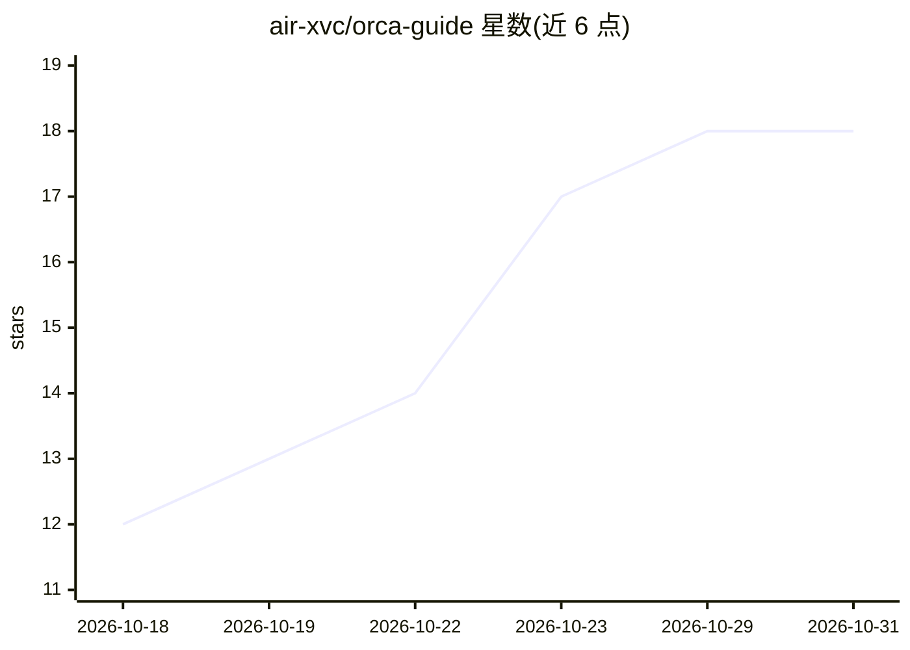

# air-xvc/orca-guide

⭐ 18 · CSS · MIT · 推送 2026-07-26 · [GitHub](https://github.com/air-xvc/orca-guide) · [官网](https://guide.rtxk.us) · 个人维护 · 中文 README

**社区编写的 Orca 中文使用指南：讲如何用 Orca 并行指挥 AI 编程 Agent**

面向中文用户的第三方文档仓库（GitHub Pages/Jekyll），整理 Stably AI 开源的并行 Agent 开发环境 Orca 的使用笔记：介绍其 ADE 定位、每任务独立 git worktree、无限分屏、编排层分派、30+ 种 CLI Agent 接入（Claude Code/Codex/Antigravity 深度集成）、三平台安装与国内使用注意事项。仓库与 Orca 官方无隶属关系，内容标注以官方为准，并链接主站教程持续更新。README 中含 Leonis AI API 中转站推广段落。

## 筛选速览

| 维度 | 判定 | 备注 |
|---|---|---|
| AI 角色 | `ai-knowledge` | 知识聚合/清单类 |
| 许可风险 | `permissive` | MIT |
| 部署形态 | `desktop` | 安装包/桌面程序 |
| 模型依赖 | — | README 未给出锁定关系 |
| 硬件要求 | — | 无带数字的原话,不猜 |
| 安装摩擦 | `low` | 无编译、无系统依赖或容器化 |
| 成熟度 | — | 结构信号不足 |

## 能力要点

- 覆盖 Orca 定位、worktree 隔离、编排、CLI 命令、Design Mode 等主题的系列中文文档
- 汇总 30+ CLI Agent 支持情况与三平台安装方式
- 提供国内落地专题：海外 API 访问、线路选型与账号安全

## 适用场景

- 想用中文了解 Orca 这款并行 Agent 开发环境是否适合自己
- 按文档从安装到接入 Claude Code/Codex/Antigravity 上手 Orca
- 查阅国内网络环境下使用多家 Agent 的避坑经验

## 场景标签

`教程课程` · 领域:学习与行业

## 证据(README 行号)

> L4: Orca 使用完全指南：一个窗口指挥多个 AI 编程 Agent
> L150: 本仓库是社区整理的 **Orca 中文使用笔记**，与 Orca / Stably AI 官方**无隶属关系**；「Orca」「Claude」「Codex」「Antigravity」「Google」等名称与商标归各自权利人所有。

## 星数曲线

2026-10-18 12 → 2026-10-31 18（+6）

---
*卡片 v1 · prompt 1.4 · 生成 2026-10-29 · 置信度 high · 依据 README sha `f1c6b0ded426` · [字段定义](../../DATASET.md)*
